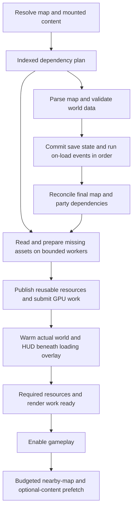

# Asset loading investigation — 2026-09-26

Implementation and fresh before/after measurements: [Asset loading implementation](ASSET_LOADING_IMPLEMENTATION.md).

The current delays are largely avoidable. Startup repeatedly scans asset directories to resolve icon names. Map
loading repeatedly decodes PNGs, rebuilds sprite atlas pages and mipmaps, and recreates textures. The existing parallel
sprite loader processes legacy sprites, while the restored atlases take a synchronous branch. Some work also escapes
the loading screen and stalls the first gameplay frames.

A private directory-index experiment reduced New Sorpigal launch time from **23.22 seconds to 8.11 seconds**, using
the same prepared save and art. It did not solve map loading: returning to New Sorpigal still took **5.12–5.30 seconds**.
Fixing lookup, avoiding repeated work, preparing runtime assets offline, and making loading completion include rendering
readiness should precede any attempt to use every CPU core.

This is an investigation and implementation plan. Production engine code and the normal executable were not changed.
Diagnostic builds and experiments are isolated under `/tmp/openyamm-loading-audit`.

## Measurements and limits

Measured on a Ryzen 9 5950X, 16 cores / 32 threads, and NVIDIA RTX 3060 Ti with 8 GiB VRAM. The ordinary Release build
uses `-O3 -DNDEBUG`; the diagnostic builds use the same compiler flags and existing libraries. Desktop runs used the
real display, OpenGL, and NVIDIA driver 595.91.07. No Vulkan build was made.

The tested settings were 1600×900, VSync off, lightmaps on, shadows and terrain decorations off, and
`wait_for_level_sprites=true`. Texture, terrain, and decoration tiers were x2; restored icons were preferred. The sprite
tier field was x1, but the map's explicit restored atlas references still loaded enhanced art. These measurements
therefore describe the current installed asset policy, not an artificial switch enabling x2 for every category.

Assets came from loose `assets_dev` files. **Filesystem caches were warm**: the isolated desktop launcher prepares its
save in a headless process before starting the measured game. No cold-disk benchmark is claimed. Startup measures the
game process reaching the saved-map-ready marker and excludes that preparation; the map timer is a subset of startup.
The transition route used ordinary pending map moves, including state restoration and events, in one process.

| Measurement | Baseline | Directory-index experiment |
| --- | ---: | ---: |
| Fresh process → New Sorpigal ready | 23.22 s | 8.11 s |
| Common item table initialization | 15.16 s | 1.20 s |
| Case-insensitive lookup inside item initialization | 14.02 s | 0.035 s |
| Initial New Sorpigal map timer | 7.45 s | 6.19 s |
| Goblinwatch transitions in one process | 3.15 / 3.13 s | 3.07 / 3.06 s |
| Return to New Sorpigal in the same process | 6.12 / 6.19 s | 5.30 / 5.12 s |

The untouched normal executable independently measured **23.82 s startup / 7.61 s map loading**. A second untouched
run under `perf` also measured 23.82 s startup. The route's first launch varied more; its baseline startup was 25.12 s.
These are a small set of controlled comparisons, not p95 estimates. Loading-screen image selection and normal desktop
activity were not fixed. The first-load screenshot was inspected; its separate capture-induced stall was excluded.

### Where time goes

Detailed New Sorpigal baseline, with nested scopes explicitly identified:

| Work | Measured time | Meaning |
| --- | ---: | --- |
| Common gameplay tables | 15,194 ms | Includes the item table below |
| Item table | 15,157 ms | Includes lookup, reads, and dimension decoding below |
| Item case-insensitive lookup | 14,020 ms / 2,216 calls | Repeated directory enumeration |
| Item file reads | 41 ms / 2,289 calls | About 55 MB read; this is not the 14-second problem |
| Item image decoding | 969 ms / 2,284 calls | Full image decode to obtain dimensions |
| Selected map data and assets | 2,991 ms | Includes terrain, models, decorations, objects, actors, and lighting work |
| Terrain / building surface stages | 356 / 583 ms | Part of selected-map work |
| Logged lightmap stage | 868 ms | Includes dependency/path work; see correction below |
| Actual lightmap parsing/decoding | 11 ms | Nested in the lightmap stage |
| Runtime initialization / on-load events | 35 / 12 ms | Small compared with asset preparation |
| Outdoor render resources | 230 ms | Separate resource setup stage |
| HUD setup | 468 ms | Initial setup, not the first visible HUD frame |
| Level sprite preload | 2,955 ms | Dominated by the restored atlases below |
| Atlas PNG decoding | 2,135 ms / 30 images | Nested in atlas loading/preload |
| Atlas repacking and mip preparation | 587 ms / 15 pages | Nested in atlas loading/preload |
| Atlas file reads | 13 ms | About 51 MB; warm file reads are inexpensive here |

Do not add nested rows. These measurements identify ownership of time, rather than partitioning every millisecond of
process startup. The CPU sample profile independently points at directory enumeration, PNG inflate/unfilter, pixel
format conversion, and atlas mip construction. Inclusive sampled percentages overlap and are not wall-time shares.

The geometry itself is small: `oute3.odm` is 1.69 MiB and reading/parsing it takes about 2 ms here. Its lightmap file is
10.57 MiB, decoding to 17.63 MiB. In contrast, the five loaded creature families occupy 15 atlas pages: 48.9 MiB of
compressed PNGs, **347.88 MiB of decoded base/mask pixels**, and **448.17 MiB of prepared texture/mipmap payload**.
Goblinwatch prepares nine pages with 309.09 MiB of texture/mipmap payload. These are measured upload-input sizes,
not measurements of total VRAM consumption or peak process memory. Surfaces, HUD, driver storage, staging, and other
resources are additional.

The old geometry does justify expecting much faster transitions. The enhanced art nevertheless creates a substantial
working set, so instant revisits should come from residency and prefetching, not hundreds of megabytes of repeated
decode and upload at each doorway.

## Confirmed bottlenecks and proposed fixes

### 1. Asset resolution repeatedly enumerates directories

[AssetFileSystem.cpp](../../engine/AssetFileSystem.cpp), `findCaseInsensitiveVirtualPath` around line 400, enumerates the
parent directory and lowercases its entries on every fallback lookup. `exists`, path resolution, and file opening all
reach this machinery. Ordered package/tier candidates multiply unsuccessful probes. Already lowercase asset names
do not prevent scans when an earlier candidate package lacks the requested file.

In the index experiment, the 2,216 item fallback calls built just four directory indexes. Lookup time dropped from
14,020 ms to 35 ms. Item PNG decoding remained about one second. Map loading also benefited: the lightmap stage fell
from 868 ms to 34 ms while the actual lightmap parser stayed at 11 ms. The existing stage name was obscuring path and
dependency-resolution cost; disabling lightmaps would address the wrong cause.

Production fix: make lookup indexing belong to `AssetFileSystem`, keyed by the effective mounted content and directory.
Resolve names once to canonical asset identities, cache both successful and absent lookups, and preserve exact-name
and package precedence. Rebuild/invalidate on mount changes, mod order, relevant quality policy changes, and explicit
development asset refresh. Validate case collisions rather than picking an arbitrary winner. Preserve the restored-icon
policy and `icon_packages.txt`; do not restore retired original icon folders as a workaround.

The private experiment used a thread-local map cleared on initialization. That proves the cost is removable; it is
not suitable production ownership or invalidation. PhysicsFS enumeration and some metadata operations also take a
shared state lock. Adding threads to repeated directory scans would retain the unnecessary work and add contention.

### 2. Global item metadata decodes thousands of images

[ItemTable.cpp](../../game/tables/ItemTable.cpp), `loadBitmapDimensions` around line 304, reads the icon and fully decodes
non-BMP images just to obtain width and height. Multiple item records can repeat the same icon work. Logical dimensions
then feed inventory sizing, so deleting this step without replacing its metadata would change gameplay/UI behavior.

Use authoritative logical dimensions and inventory cell sizes in asset/item metadata. Where metadata is not yet
available, read and validate image headers once per resolved asset, without decoding pixels. Apply existing scale-tier
conversion consistently. Reviewed sizes already present in `item_visuals.txt` should be consumed before unnecessary
dimension work where applicable.

Keep the global item registry: the party can carry items between worlds. Avoiding these decodes is preferable to
incorrectly stripping global item rows or imposing world-local ownership on carried items.

### 3. Restored atlases are cooked synchronously during loading

[SpriteAtlasCache.cpp](../../game/render/SpriteAtlasCache.cpp) reads the base and mask PNGs, decodes them, constructs packed
pages/mips, creates textures, and builds hit-mask data. [SpriteAtlasMipmaps.cpp](../../game/render/SpriteAtlasMipmaps.cpp)
performs packing, padding, alpha-aware filtering, and edge treatment. Individual observed cache misses cost roughly
180–258 ms in the detailed outdoor run.

[OutdoorBillboardRenderer.cpp](../../game/outdoor/OutdoorBillboardRenderer.cpp),
`preloadPendingSpriteFrameWarmupsParallel` around line 1624, branches directly to synchronous loading for `atlas:`
references and restored decorations before entering its worker path. Legacy sprite requests can use up to eight
decode workers. The expensive new assets therefore do not receive that benefit. Indoor atlas warmup is also serial.

Two complementary fixes are needed:

- Prepare independent atlas pages and ordinary texture images on a bounded shared CPU worker queue. Publish completed
  resources through the owning cache, deduplicating concurrent requests for the same asset.
- Move invariant packing, padding, hit-mask generation, channel conversion, and mip generation into the asset build.
  Load validated runtime pages directly. Keep PNGs as authoring sources and use explicit content/tool-version
  fingerprints to rebuild stale cooked data.

Lossless prepared pages are a useful first step. GPU-native compression can additionally reduce upload and residency
cost, but must pass visual and mask correctness checks. Choose formats using platform capabilities; desktop BC formats
are not a universal Android solution. Palette weights and alpha edges must retain their intended semantics. Generic
whole-atlas mip generation must not replace the current per-cell filtering/padding guarantees.

The decoder also does avoidable conversion work. An isolated experiment used bimg's RGBA output plus a direct byte
channel swap instead of the generic BGRA conversion path. Across the same 30 atlas images, two alternating runs gave
**2.24 / 2.02 s baseline versus 1.51 / 1.52 s**, with identical dimensions and full decoded-pixel hashes for every image.
That is 0.50–0.73 s saved in this decoder corpus, not an established full-game speedup. Other PNG types, transparency/key
handling, and malformed inputs need coverage before changing the shared decoder.

### 4. Map teardown discards reusable textures

Outdoor and indoor renderer shutdown destroy their atlas caches. The map loader also clears transient bitmap buffers.
Returning to a map thus repeats the atlas work: the five-map route prepared 63 pages and decoded 126 PNGs, spending
8.73 s decoding and 2.37 s rebuilding pages/mips. The index experiment left these costs essentially unchanged.

Move ownership of reusable static textures/atlas pages into an engine/session resource cache used by both renderers.
Map instances own references, geometry, and gameplay state. Keep active dependencies pinned and retain recently used
or next-destination assets within an explicit memory budget. Evict by byte cost and usage, with safe deferred GPU
destruction. Keys must include resolved package/world identity, content generation, tier, and relevant variant/filter
policy; bare filenames would collide across worlds and mods.

This is a change in authoritative ownership, not another forwarding cache around two renderer-owned copies. Continue
releasing upload-source RGBA buffers after publication; retaining every decoded image would waste RAM. Budget staging
buffers separately from GPU residency, especially while two map working sets overlap.

There are already useful caches to preserve. **Shared gameplay UI survives same-world transitions**: subsequent HUD
bootstrap measured about 0.017 ms. Do not describe all UI as being recreated at every doorway. Conversely,
[MapAssetLoader.cpp](../../game/maps/MapAssetLoader.cpp), around line 2601, preloads common object-description sprites during
each full gameplay map load. Their reusable resources should have session lifetime while retaining coverage.

## Loading completion must include the first real frame

Measured initial gameplay frames were **72–81 ms**, mostly HUD work. The first minimap load alone took **38–44 ms**.
After returning outdoors, two gameplay frames took **108–133 ms**, with **105–132 ms inside `bgfx::frame`**. These were
separate from the expected multi-second transition callback under the loading overlay. A screenshot-induced 186 ms frame
was excluded. A separate roughly 22 ms timer-event spike was also observed; it is not evidence of asset loading.

[GameplayUiRuntime.cpp](../../game/ui/GameplayUiRuntime.cpp), `preloadReferencedAssets`, warms statically referenced UI
assets, but actual minimap, portrait, and dynamic bar requests can still load during drawing. In
[GameApplication.cpp](../../game/app/GameApplication.cpp), `completeLoadingOverlay` submits the final overlay frame and
immediately clears the overlay. Gameplay readiness principally checks map state and pending outdoor sprite warmup.

Build a concrete required-asset set for the finalized map and party: map textures and their animations, actual HUD and
minimap, portraits, relevant inventory/paperdoll art, actors' animation directions/states, foreseeable map spawns,
projectiles/spells/effects, and required sound effects. Save restoration and on-load events can change dependencies,
so reconcile the set after these deterministic steps. Warm the real world and HUD render paths beneath the overlay,
without advancing gameplay or firing input/events twice.

A valid bgfx handle does not mean its GPU resource already exists. bgfx queues resource commands to the render thread;
`frame` can wait on rendering progress. Resource API calls are internally synchronized, but the game's mutable caches
are not thereby thread-safe. Use a clear resource-publication owner and track work through rendering readiness, rather
than treating CPU decode completion as sufficient. [bgfx internals](https://bkaradzic.github.io/bgfx/internals.html)

The measured waits establish render-submission backpressure, not its exact GPU cause. A targeted GPU/API trace should
separate upload completion, driver allocation, shader first use, and ordinary rendering when implementing this stage.
An unconditional sleep, or `glFinish` in every gameplay frame, would not be an appropriate readiness mechanism.

Additional synchronous paths found by source inspection, **not timed by these short map tests**:

| Path | Potential first-use work | Treatment |
| --- | --- | --- |
| `GameplayUiRuntime::loadHudTexture` / item-icon loading | Icon/portrait/minimap read, decode, upload | Warm actual visible state and current interaction dependencies |
| `EffectRenderer::loadTexture` | FX image read/decode/upload from rendering, before distance rejection | Declare complete relevant effect animation dependencies and prepare ahead |
| `ModelRenderer::prepare` | Mesh buffers and textures on first draw | Prepare models present in the selected content, without loading unrelated worlds |
| `AudioSystem` cache miss | WAV read, decode, conversion | Keep common gameplay audio resident; prepare contextual speech/sounds before playback |

Music already has asynchronous decoding, although its initial file read occurs on the caller. Map gameplay sound
preload was only about 18 ms in Goblinwatch. Avoid replacing working paths indiscriminately.

Do not turn off `wait_for_level_sprites` to claim a faster load. The deferred outdoor queue uses a request count rather
than a reliable time/byte budget, and a single atlas miss can exceed an entire frame budget many times over. For optional
content, enqueue bounded background preparation before it becomes necessary; required content stays behind readiness.

## What can run in parallel, and what must retain order

Use the same loading coordinator and asset ownership for indoor and outdoor worlds, with format-specific geometry
loaders. Start by measuring 2, 4, and 8 workers, with both in-flight byte and job limits. Thirty-two simultaneous large
PNG decodes would multiply transient memory and compete for bandwidth. Keep the loading UI responsive while jobs run.

| Work | Scheduling |
| --- | --- |
| Resolve/deduplicate dependency names | Indexed immutable lookups; one canonical request per resource |
| Read independent files | Limited I/O queue or batched reads; avoid repeated shared directory enumeration |
| PNG decode, swizzle, per-page filtering/mips, hit masks | Independent CPU jobs until offline cooking removes them |
| Geometry parsing/validation and pure derived-data construction | Jobs where input/state is immutable and profiling justifies it |
| CPU audio conversion / model preparation | Independent jobs using owned buffers and suitable library contexts |
| Cache insertion, GPU handle ownership, scene publication | Controlled commit/publication with defined lifetime |
| Save deltas, respawn decisions, party/world state, Lua on-load events | Deterministic ordering; do not mutate shared gameplay state from arbitrary workers |
| Actual driver/GPU resource work | Render-thread/GPU pipeline; overlap preparation without assuming cores eliminate upload cost |



Keep collision/geometry correctness, save and respawn semantics, event ordering, namespaced content precedence, logical
sprite dimensions/placement, palette variants, hit masks, and alpha-safe mip filtering. Keep corruption/staleness
validation; optimize repeated lookup and cache validated results using content identity. The 35 ms runtime setup and
12 ms on-load events are poor targets for risky behavior changes.

## Comparison with other engines

### Local OpenEnroth reference

This comparison is structural; OpenEnroth was not benchmarked and no code was copied.

- [LodReader](../../reference/OpenEnroth-git/src/Library/Lod/LodReader.cpp) indexes archive entries on open and resolves reads
  through that index. It does not discover each asset by rescanning a loose directory.
- [LodTextureCache](../../reference/OpenEnroth-git/src/Engine/Resources/LodTextureCache.cpp) and
  [LodSpriteCache](../../reference/OpenEnroth-git/src/Engine/Resources/LodSpriteCache.cpp) cache by normalized name and provide
  reserved resources that survive release of map-specific entries.
- [Engine.cpp](../../reference/OpenEnroth-git/src/Engine/Engine.cpp) initializes common object/overlay sprites and reserves
  resources before ordinary map resets. [Actor.cpp](../../reference/OpenEnroth-git/src/Engine/Objects/Actor.cpp) prepares actor
  animations, and [Sprites.cpp](../../reference/OpenEnroth-git/src/Engine/Graphics/Sprites.cpp) walks animation frames and
  octants while avoiding repeated initialization.
- Its map preparation is substantially synchronous. [GraphicsImage](../../reference/OpenEnroth-git/src/Engine/Graphics/Image.cpp)
  also has lazy decode/texture creation, so OE is not proof that lazy loading guarantees hitch-free enhanced assets.

The useful lessons are indexed lookup, common-resource residency, and explicit animation dependency preparation.
Its original-sized assets do not establish a performance budget for our restored atlases.

### OpenMW and modern engine pipelines

OpenMW is a directly relevant RPG example. It supports background cell preparation, preloading around doors/exterior
borders, a bounded cell cache, and a graphics-work budget related to the target frame rate. Preloading every fast-travel
destination is optional because of memory cost. Adopt selective destination prediction after the basic cache and
pipeline work. [OpenMW cell loading settings](https://openmw.readthedocs.io/en/latest/reference/modding/settings/cells.html)

Unity separates texture/mesh metadata from payload in built data and feeds asynchronous loading through a staging
buffer and upload budget. This supports our separation of cheap metadata, CPU preparation, and GPU publication.
[Unity texture and mesh loading](https://docs.unity3d.com/6000.0/Documentation/Manual/LoadingTextureandMeshData.html)

Unreal's asset registry provides metadata without loading every object, while grouped asynchronous requests and
managed references express dependencies and lifetime. We need these principles in the existing engine, not a new
general-purpose engine framework.
[Unreal asynchronous asset loading](https://dev.epicgames.com/documentation/en-us/unreal-engine/asynchronous-asset-loading-in-unreal-engine)

For shipping, retain authoring PNG/TXT files and generate indexed runtime metadata plus cooked payloads. ZIP packaging
alone cannot remove PNG decoding or mip construction. Avoid redundant archive compression for already compressed
payloads where measurement supports storing them directly. bgfx's `texturec` supports runtime texture containers and
formats, but our atlas-specific filtering rules still need to be preserved by the asset pipeline.
[bgfx texture tools](https://bkaradzic.github.io/bgfx/tools.html)

## Implementation order and acceptance criteria

1. **Index asset lookup and remove item pixel decoding for metadata.** Smallest scope and strongest measured payoff.
   Validate exact/case-insensitive resolution, absent candidates, package priority, mount/refresh invalidation, and logical
   inventory sizes. The index-only experiment already establishes a roughly 15-second startup reduction on this setup.
2. **Close the initial-frame readiness gaps.** Include actual HUD/minimap/portraits and final map dependencies; render
   underneath the overlay until the required preparation/publication work is complete. Keep frame-stage attribution so
   render waits cannot silently move from the load timer into gameplay.
3. **Give reusable resources session ownership and a memory budget.** Eliminate re-decoding/re-uploading retained atlas
   pages and common object textures on round trips. Validate indoor/outdoor sharing, cross-world keys, eviction, and
   renderer shutdown. Preserve the already working shared UI lifetime.
4. **Parallelize remaining CPU preparation and improve byte conversion.** Extend the shared path to restored atlases,
   decorations, surfaces, and appropriate audio/model work. Measure wall time and peak bytes at several worker counts.
   Use one outstanding preparation per canonical resource, cancellation, and safe cleanup on failed/abandoned loads.
5. **Cook runtime atlas/texture data.** Remove repeated packing/filtering/mip work and PNG inflation from normal packaged
   gameplay. Add explicit format/version/content validation and visual comparisons for any compression. Re-measure upload
   cost after reducing CPU work.
6. **Prefetch likely destinations and contextual content.** Use nearby doors/travel choices and bounded recent-map
   residency. While gameplay runs, cap publication by measured time and bytes, respect frame headroom, and cancel stale
   requests. Avoid loading every world or all travel destinations.

Provisional performance goals on this desktop, to validate rather than promise: **1–2 seconds for a fresh process with
warm disk caches**, and **250–500 ms typical nearby/cached transitions**, with subsecond p95 for that transition class.
An uncached transition has a different I/O/upload budget and must be reported separately. No current measurement
demonstrates these targets yet.

For gameplay, require zero synchronous file reads, image decodes, or mip builds on exercised critical draw paths after
readiness. Begin with at most 0.5–1 ms of optional main-thread asset publication per frame and adjust to actual headroom:
the *entire* frame has 16.7 ms at 60 Hz or 8.3 ms at 120 Hz. Record p95, p99, maximum, and counts over 16.7/33/50 ms;
attribute asset work separately from simulation, driver waits, screenshots, and unrelated events.

The implementation benchmark matrix should cover fresh process/warm disk, cold disk, first entry, repeated round trips,
and prefetched entry; indoor/outdoor MM6/MM7/MM8; relevant MM9 mounted/unmounted behavior; loose and packaged assets;
cross-world travel; constrained memory; and Android Release where the changed path applies. Exercise turning, combat,
all relevant actor animations, spells, loot, inventory, portraits, speech, and event-driven spawns. Report CPU/GPU staging
and resident bytes alongside timings. These checks are future acceptance work, not tests already performed here.

## Evidence and reproduction

Evidence is temporary and outside the production tree. Retain it before cleaning `/tmp` if follow-up work needs it.

| Evidence | Location |
| --- | --- |
| Untouched native baseline | `/tmp/openyamm-desktop-loading-audit-sorpigal-x2-3y3ax5co/` |
| Untouched process under CPU profiler | `/tmp/openyamm-desktop-loading-audit-sorpigal-profile-84mx0zob/` |
| Detailed outdoor baseline | `/tmp/openyamm-desktop-loading-audit-detailed-kfdl7svh/` |
| Detailed indoor baseline | `/tmp/openyamm-desktop-loading-audit-goblinwatch-ij_jvatp/` |
| Directory-index experiment | `/tmp/openyamm-desktop-loading-audit-index-trial-rz__xq4g/` |
| Baseline round-trip route | `/tmp/openyamm-desktop-loading-audit-transitions-th44prte/` |
| Indexed round-trip route | `/tmp/openyamm-desktop-loading-audit-transitions-index-jxdhz5pz/` |
| Combined run metadata, metrics and stages | `/tmp/openyamm-loading-audit/summary.json` |
| Diagnostic build/route/index/decoder scripts and pixel hashes | `/tmp/openyamm-loading-audit/` |
| CPU profile and normalized reports | `/tmp/openyamm-loading-audit-sorpigal.perf.data`, `/tmp/openyamm-loading-audit/perf-*.txt` |

Each run directory includes `run.json`, copied settings/save data, and game/preparation logs. The detailed outdoor,
index, and both route runs used prepared save SHA-256
`2c15c3a6c7d4557ad6a03497f1afdc9e00555c0ea3cb1d0a1f94828f8ad758bb`.
The untouched game executable SHA-256 was
`a34c9ba1f5a3ded71b350014661cb2eb45faf406e91db6300154d523d0c9b864`.

The ordinary launcher command shape was:

```sh
./tools/run_game.sh --isolated loading-audit-example --world mm6 --map oute3.odm \
  --warmup 0 --seconds 6 --set logging.hitch_trace=true --set logging.hitch_threshold_ms=16
```

The comparisons instead supplied the same saved game via `--save`, and diagnostic runs selected their private binary
through the launcher's `--binary` option. `build_route.py` injected pending map moves after two seconds of ready
gameplay: `oute3.odm → 6d01.blv → oute3.odm → 6d01.blv → oute3.odm`. It did not use a shortened debug-jump path.

CPU profiling used `cycles:u`, 199 Hz, DWARF call stacks, and filtered the report to actual game PID 427074, excluding
launcher/headless preparation. The filtered reports contain about 13,000 samples and report no lost samples. Some unwind
frames were unresolved; this is not a GPU trace. `kernel.perf_event_paranoid` was temporarily changed from 4 to 2 and restored
to 4 after collection. Original instrumented-source hashes are in `source_hashes.json`; diagnostic source copies and
objects were linked into private executables without replacing the normal build.
