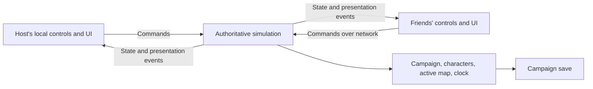

# Multiplayer architecture investigation

Investigated 2026-09-27 against the current working tree and the local MMMerge reference snapshot.
This document records findings and proposed architecture. It does not authorize implementation or establish
new repository-wide rules. No networking, gameplay, asset, or save-format implementation accompanies it.

The follow-up [listen-server architecture](MULTIPLAYER_LISTEN_SERVER_ARCHITECTURE.md) develops this investigation into
a concrete implementation proposal and recommended gameplay rules, including rest, training and shared time.

**Recommendation:** build small-group cooperative campaigns around one authoritative simulation, initially hosted
inside a player's game. Preserve a path to running that same simulation as a dedicated server. OpenYAMM has useful
shared gameplay systems to build on, but needs a substantial change to state ownership and simulation entry points.
An engine rewrite is not indicated by this investigation.

The working gameplay assumption is that each person moves independently and controls one or more characters sharing
that person's position. Three people with one character each produce three moving groups; two people with two
characters each produce two moving groups containing four characters. This is a proposed interpretation, not a
confirmed requirement. Separate bodies and following AI for every character would be additional scope.

**Hosting and authority are separate choices.** A listen server runs the authoritative simulation alongside the
host's local client. A dedicated server runs it without a local player or presentation. Either can own all world
state. Peer-to-peer connectivity or a relay describes packet routing and does not require distributed simulation
authority. These distinctions also appear in
[Epic's networking overview](https://dev.epicgames.com/documentation/unreal-engine/networking-overview-for-unreal-engine).

| Approach | Fit for OpenYAMM |
| --- | --- |
| Authoritative listen server | Recommended first product: one friend selects Host, others join; one campaign save. |
| Authoritative dedicated server | Useful later for availability without a particular friend online; same simulation and protocol. |
| Distributed authority between clients | Unnecessary ownership transfers and competing mutations for this scope. |
| Deterministic lockstep | Would require auditing simulation determinism across physics, Lua, ordering, RNG, and platforms; poor starting fit. |
| One shared party position, several controllers | A smaller alternative if shared movement is acceptable, but does not provide independent exploration. |

In a listen server, the local player should submit the same gameplay commands as remote players. The local transport
can be an in-process queue; it need not serialize packets or use a socket in single player. There should be one
simulation, not a server copy plus a second independently authoritative local game. Dedicated hosting then changes
the executable/lifecycle and presentation, rather than introducing a different rules implementation.

For a dedicated server, remove the host's local controls/UI from this diagram. Single player has just one local
controller and no network connection.

**What the local MMMerge code actually does.** The substantial multiplayer reference is in
`reference/a/mmmerge`, rather than the main `reference/mmmerge` tree. Its
[description](../../reference/a/mmmerge/Scripts/Multiplayer%20description.htm) documents hosting/joining, UDP connections,
monster puppets, constrained chest/NPC access, multiplayer spells, rest, turn-based combat, and players on different
maps. The description explicitly acknowledges minimal server checks and the constraints of modifying a game without
its source. This is evidence about the supplied snapshot, not a claim about the latest upstream release.

The inspected implementation supports these points:

- [Monster ownership](../../reference/a/mmmerge/Scripts/Modules/Multiplayer/Synchronization/Monsters/Ownership.lua)
  transfers simulation responsibility between players and broadcasts ownership changes.
- [Remote player representation](../../reference/a/mmmerge/Scripts/Modules/Multiplayer/Synchronization/Players/Monster.lua)
  uses monsters with a special puppet AI type and a configured skin. A race-appropriate billboard is a reasonable
  presentation idea; the inspected evidence does not establish an automatic minotaur-race-to-skin rule.
- [Turn-based synchronization](../../reference/a/mmmerge/Scripts/Modules/Multiplayer/Synchronization/TurnBased.lua)
  exists. The reference is not limited to realtime combat. The description explains player readiness barriers and
  lists turn-based animation and movement defects.
- [Save/load synchronization](../../reference/a/mmmerge/Scripts/Modules/Multiplayer/Synchronization/SaveLoadExit.lua)
  gathers player data and shared game data; it is more than sending positions.
- The description says players on different maps have independent clocks and adopt another map's time on arrival,
  allowing time to move backward or forward. It also documents serialized chest/dialogue access and movement batching.

These are useful examples of gameplay decisions and failure cases. OpenYAMM should reuse the lessons, not the
memory-hook implementation or distributed monster ownership. No MMMerge runtime was launched, crashes reproduced,
or crash causes established here. Hosting inside a player's process is not, by itself, an explanation for crashes.

**OpenYAMM's existing structure provides a starting point, with specific limitations.**

| Inspected area | Existing capability | Multiplayer consequence |
| --- | --- | --- |
| [GameSession](../../game/app/GameSession.h), [updateGameplay](../../game/app/GameSession.cpp) | Shared orchestration, services, snapshots, one clock | One party, active world, input frame, UI state and pending transition; update mixes local input/modal state with simulation. |
| [Party](../../game/party/Party.h) | Character inventories, combat stats, buffs, quests, shop stock and NPC state | Campaign, controlled group, character and local selection concerns share one owner; cloning Party per client would duplicate campaign state. |
| [OutdoorPartyRuntime](../../game/outdoor/OutdoorPartyRuntime.h), [IndoorPartyRuntime](../../game/indoor/IndoorPartyRuntime.h), [IndoorSceneRuntime](../../game/scene/IndoorSceneRuntime.h) | Movement/runtime state can be snapshotted | Both movement runtimes own a Party value, with scene/session copies and synchronization. Ownership must be normalized. |
| [GameplayRuntimeInterfaces](../../game/gameplay/GameplayRuntimeInterfaces.h) | Shared gameplay interface for indoor/outdoor worlds | Singular party position/access, rendering, input, UI and world operations coexist. It is not yet a server-only simulation interface. |
| [Actor AI facts](../../game/gameplay/GameplayActorAiTypes.h), [AI system](../../game/gameplay/GameplayActorAiSystem.h) | Shared AI with explicit facts and results | Party targeting, awareness and distance fields assume one spatial party; multiple groups need explicit identities and candidates. |
| [Projectile service](../../game/gameplay/GameplayProjectileService.h) | Shared projectiles, IDs and snapshots | A party source/member index does not identify which independently moving group fired; collision and damage targets also need explicit identity. |
| [Combat controller](../../game/gameplay/GameplayCombatController.cpp) | Shared damage/effect handling | Some combat RNG is seeded using animation ticks obtained through screen runtime; outcomes must use simulation-owned time/RNG. |
| [EventRuntime](../../game/events/EventRuntime.h), [Lua event execution](../../game/events/EventRuntime.cpp) | Shared event execution, map/global variables, scene hooks | Singular Party/current member, dialogue continuation and pending output fields need an initiating player/group and explicit recipient scope. |
| [GameSaveData](../../game/maps/SaveGame.h) | Party and per-map snapshots, package requirements | One party/position plus local camera and held-item UI state; requires a versioned multiplayer campaign schema, not a raw network dump. |
| [ScenarioRuntimeDriver](../../game/scenario/ScenarioRuntimeDriver.cpp) | Headless scenarios already drive shared gameplay paths | Good test infrastructure, but still uses GameApplication, screen state and runtime bindings; not an existing dedicated server. |
| [World activation](../../game/app/GameApplication.cpp), [content manifests](../../game/content/ContentManifest.h) | Mounted worlds, package schemas, shared data | World activation changes application/asset-loader context; simultaneous maps across worlds need explicit per-map context. |

The renderer, audio, maps, asset formats, data tables, collision primitives, much of the movement code, and gameplay
formulas remain useful. The changes concentrate on ownership, callers, target selection, time, persistence and
presentation boundaries. Existing shared systems reduce duplication, but they do not mean multiplayer is a transport
library away. The table is a targeted source audit, not an exhaustive call-site inventory or effort estimate.

A dedicated executable would still need a data-only startup path and build dependencies separated from rendering,
audio and local input. Keep simulation-relevant animation timings and collision metadata available without loading
textures or playing animations. Simply disabling the renderer in the current application does not establish that
its gameplay loop can run correctly without a local screen or player.

**Separate the campaign from the people controlling it.** The following names describe responsibilities, not a
requirement to introduce this exact list of classes or a general entity/component framework.

| State | Authoritative responsibility |
| --- | --- |
| Campaign | Global QBits/variables, shared journal/history, NPC changes, shop stock, shared resources, unique rewards/artifacts, rules and calendar. |
| Character roster | Stable character IDs, stats, skills, conditions, equipment, inventory and character-specific awards/progression. |
| Controlled group | Stable group ID, character membership, map, position, velocity, movement modes, group effects and collision body. |
| Map instance | Namespaced map identity, monsters, doors, mechanisms, triggers, chests, dropped items, timers and projectiles. |
| Player session | Stable campaign participant identity and control assignments; connection identity and input acknowledgements are transient. |
| Client presentation | Local camera, selected character, hover/inspect state, windows, sound playback and rendered interpolation. |

For example, participant A owns control of characters C1/C2 in group G1; B controls C3/C4 in G2. Each character exists
once in the authoritative roster. The camera follows the participant's group. Selecting C2 changes A's command
subject, not B's selection or a global active-member variable. A character must have at most one active controller.
The server checks that assignment on every gameplay command, including after reconnects or reassignment.

A shared campaign does not imply shared position. Conversely, separate positions do not require separate QBit
registries. Keep the merged base's global QBit model and character-specific progression distinct. Shared shop stock,
artifact uniqueness, NPC changes and quest rewards must have one owner. Group buffs and movement abilities must be
scoped explicitly instead of inheriting all fields from today's Party.

For the first supported ruleset, propose two to four people and at most five active characters across the expedition.
The current Party has a five-member limit and five-entry character buff storage. This cap preserves a manageable
initial content/HUD envelope; it does not make those arrays network-ready or prove combat remains balanced. Independent
positions change kiting, targeting and damage exposure even when the total character count stays the same.

A remote group can initially use one billboard representing its selected/representative character, with a name and
portraits for its members. Use existing sprite animation/rendering machinery with a player/group visual definition.
Do not make the logical player a monster with disabled AI: monster loot, death hooks, factions and quest kill counts
must not accidentally apply to it. Separate character bodies would also require following, body-specific collision,
camera switching and rules for abandoned/downed characters, not just extra sprites.

**A first cooperative ruleset should make shared-world behavior explicit.** These defaults are proposals to review
before implementation, rather than assumptions silently embedded in networking code.

| Situation | Proposed first behavior |
| --- | --- |
| Exploration | Independent groups on one active map; players can separate within that map. |
| Entering another map/world | A group transition with readiness/consent, destination validation and a load barrier. |
| Combat | Realtime initially; retain the existing single-player turn-based mode. Cooperative turn-based combat is a later shared scheduler/barrier feature. |
| Inventory, spellbook, inspection | Local UI does not pause the campaign. An explicit agreed session pause is a separate action. |
| Quests and journal | One campaign progression; rewards committed once with explicit eligible character recipients. |
| Gold, bank and food | Shared expedition resources initially, with serialized spends. Character inventories remain separate. |
| Loot and trading | Server grants each item once. Start with one interaction lease per chest; transfers commit atomically. |
| Quest dialogue | One controller for a conversation; other participants may observe. Choices and rewards execute once. |
| Shops and services | Shared stock with authoritative purchases; local service UI. Any service that advances time joins the shared time-change policy. |
| Rest, wait, training, long travel | Agreed campaign time advance, with eligibility and interruption rules. One person cannot advance everyone else's clock silently. |
| Spells | Explicit friendly character/group targets. Group buffs affect the caster's group initially; healing another group requires a selected target and range/LOS rules. |
| Flight, water walking and teleportation | Movement effects scoped to groups; map-changing spells use the group transition protocol initially. Audit damage-area and movement spells separately. |
| Friendly fire and body blocking | Cooperative damage policy and player-player collision must be explicit; propose friendly fire off and nonblocking allied groups initially. |
| Death | One defeated group does not invoke campaign-wide defeat while another can act. Revival and full-expedition defeat are separate outcomes. |
| Disconnect | Keep authoritative characters/items; stop accepting old inputs. Proposed initial policy: pause for reassignment or reconnect, then move unassigned characters into reserve only at a safe boundary. |
| Joining/rejoining | Attach to an existing campaign and assigned characters; receive current state. No merging arbitrary personal campaign saves. |

The spell defaults need gameplay review: a one-character healer should be able to heal a friend's character, while
the scope of Day of the Gods, Invisibility, Fly, Town Portal, Lloyd's Beacon and area damage cannot be inferred from
single-player party membership. Likewise, attacks against a two-character group should resolve against that group's
members, rather than selecting a character from another group across the map. Global effects remain global only
when the spell/event definition intends that scope.

House screens also need a deliberate safety rule. A coherent initial policy is a server-validated house visit that
makes that group unavailable as a world combat target until exit, with the same eligibility applied to every player.
Opening an arbitrary menu must not grant safety. Rest, training and travel still require shared calendar handling.

**Events and time are likely to cost more than the visible multiplayer features.** In EventRuntime,
`resolveTargetMemberIndices` resolves Current through the Party's active member and All through that Party's members.
The runtime also stores a single dialogue continuation and pending map move. Two simultaneous conversations cannot
safely reuse those fields without separating their interaction context.

Future server event execution needs an initiating participant, group, character, map and interaction ID. Define how
each legacy selector maps to recipients: the acting character, the acting group, eligible expedition characters or
campaign state. Do not globally interpret every legacy All as every connected character. A fountain, promotion,
quest reward, teleport and map-load hook can have different intended scopes. Spatial triggers must identify the
group that crossed them; trap damage and mechanisms must operate on the relevant bodies.

Run authoritative Lua mutations and map timers once on the server. Send resulting state and addressed presentation
events to clients. Do not run the same rewarding script on every client and reconcile the resulting saves. A dialogue
choice must be checked against the live server interaction and quest state; repeating a request must not repeat an
item/XP grant. Client presentation must not replay authoritative effects on reconnect. Suspended interactions require
explicit cancellation or durable continuation semantics at a save/load boundary.

Audit content by behavior and patch the exporter or an explicit event overlay where needed. Do not hand-edit generated
EVT Lua. This architecture does not require rewriting all event content immediately, but a production multiplayer
release would require representative quest/service/transition coverage across the supported mounted worlds.

Keep three notions of time separate: monotonic simulation ticks, campaign calendar time, and local rendering time.
Only the authority advances gameplay time. Rest can jump the campaign calendar without rewinding network ticks.
Combat random outcomes need server-owned RNG/time instead of a screen's animation clock. For future simultaneous
maps, use one campaign calendar and explicit sleeping-map timer catch-up; never reconcile independent calendars by
moving time backward. Single-player pause and speed controls should retain their existing behavior under the offline
ruleset, rather than changing merely because the simulation has been extracted.

**Commands and state replication should form the boundary.** Inputs describe intent: move this group, attack with
this character, cast this spell at this target, take this item, choose this dialogue option. The authority validates
ownership, current map, distance/LOS, recovery, resources and interaction state before changing anything. It owns
monster AI, damage, drops, inventory, rewards, doors, timers and calendar changes. The host player follows that same
path. This is valuable for consistency even in a trusted group of friends.

Use a simulation tick independent of rendering. Clients can predict their own movement and reconcile to acknowledged
server state; remote movement is interpolated. Share the movement/collision implementation between prediction and
authority, while keeping damage and rewards authoritative. Prediction replay must not fire scripts, grant loot,
advance quests or duplicate effects. Dynamic doors and moving platforms require authoritative state in movement
correction. Full-world rollback, lockstep and competitive-shooter lag compensation are not initial requirements.

Monsters should be active around the union of relevant player groups and select among valid group/character targets.
The host must simulate a remote client's battle even if the host's own group is far away. Deduplicate active sets and
reuse spatial queries rather than ticking a monster independently for each group. Measure costs with separated
groups; a single-player performance result does not establish the multiplayer budget.

| Traffic | Delivery/consistency requirement |
| --- | --- |
| Movement inputs and pose snapshots | Sequenced updates; discard old data, acknowledge inputs, recover dropped input history as needed. |
| Attacks, item operations, dialogue and transitions | Reliable commands with IDs, validation and application-level duplicate protection. |
| Durable state changes | Revisioned authoritative results; a late snapshot must not overwrite a newer item/quest change. |
| Joining and resynchronization | Snapshot at a known tick/revision plus changes since that boundary; enable play after acknowledgement. |
| Sounds, particles and hit presentation | Event identities to suppress duplicates; relevance and delivery policy may differ from durable state. |

Use explicit protocol serialization and limits; do not send native struct layouts, pointers, arbitrary Lua code or
the save archive as the live protocol. Existing actor/projectile IDs are a useful start, but need map/instance and
generation/epoch context. Character and item type IDs are not unique character/item instance identities. Array
indices can remain internal but are not sufficient long-lived network references.

A session epoch and map-load epoch should invalidate packets from before a load/transition. Stable campaign
participant and character IDs survive reconnection; connection IDs do not. State snapshots need an acknowledged
baseline or a full resynchronization path. Item operations require one atomic authoritative result: two clients
requesting the same sword yield one grant, and retrying the winning command returns its previous result.

Match protocol/build compatibility, gameplay package order/schema and content fingerprints before entering a session.
The existing save package requirements are a useful starting point but do not establish identical collision data,
scripts or gameplay tables. Approved cosmetic differences can be considered later. Keep canonical namespaced content
IDs; do not reinterpret raw MM6/MM7/MM8 numbers as universal network identities.

**Transport selection is secondary to ownership, but internet connectivity needs its own work.** Evaluate a maintained
game transport rather than implementing UDP reliability and cryptography in-house. One candidate is
[Valve's GameNetworkingSockets](https://github.com/ValveSoftware/GameNetworkingSockets), which provides reliable and
unreliable messages, encryption, connection statistics, and loss/latency simulation. Its documentation explicitly
excludes entity serialization and delta encoding, so it does not provide OpenYAMM's replication model.

Start an eventual prototype with local connections/direct addressing. A friendly internet Host/Join experience also
needs discovery/invites, signaling, NAT traversal and a relay option where direct connectivity fails. A relay forwards
traffic; it is not the authoritative game simulation. The open-source transport does not automatically grant access
to Steam's relay service; service availability and deployment need a separate choice.
[Steam Datagram Relay documentation](https://partner.steamgames.com/doc/features/multiplayer/steamdatagramrelay)
explains that distinction. No library integration, mobile compatibility check or service-cost assessment was done here.

**Persistence belongs to the campaign authority.** Extend/version the existing save architecture to contain the
shared campaign, canonical characters, group assignments/positions, map state, RNG/timers and relevant transaction
state. Write a consistent snapshot at a simulation boundary and commit the file atomically. Inventory items being
dragged cannot exist only in client UI: either retain authoritative ownership until a move commits, or represent
the pending item explicitly. Cancel/release interaction leases on disconnect and define save/load handling for them.

Clients can remember connection and view preferences, but must not restore an older local character inventory over
the server's copy. An existing single-player save can later be explicitly migrated to a campaign with one initial
group and assigned characters. Preserve the original save; do not silently merge independent single-player histories.
Reserve characters and participation rules need a defined policy for quest rewards and later promotions, so being
offline cannot accidentally duplicate rewards or make a unique quest permanently impossible for a returning friend.

For the first listen-server release, host departure ends the live session; resume from the authoritative save.
Transferring a stopped campaign save so another friend can host is a much smaller feature than live host migration.
Live migration requires authority election, state transfer and protection against two surviving hosts, and should
be a separate decision. The trusted host remains able to alter its own campaign; a listen server is not protection
against a dishonest host.

**A hosted private campaign makes sense; a public persistent world is a different game design.** A dedicated process
can retain one friends' campaign, allow permitted participants to reconnect, and pause campaign time when nobody is
present. That removes dependence on the original host's availability without requiring an MMO. It still needs
durable identity, join permissions, backups, unattended lifecycle handling and policies for absent characters.
One friend playing while others are offline also needs an agreed progression policy, even on a private server.

The larger boundary is simultaneous independent maps/campaign histories. A server where one person trains for a week,
another fights in a dungeon, and a third completes a unique world quest must define whose time, rewards and story
are affected. Multiple active maps require per-map simulation ownership, explicit world/content context and resource
budgets; current stored map snapshots do not mean those maps can all simulate concurrently.

An open world for unrelated joining players adds competing one-shot quests, unique items, respawn rules, character
progression scopes and administration. It may need instanced campaigns or different content. Those are product and
content changes, not benefits automatically obtained by choosing a dedicated server. A later hosting service could
run separate private campaign instances rather than forcing unrelated groups into one global QBit history.

**A future implementation should advance through reviewable slices.** These are proposed acceptance boundaries,
not work started by this investigation.

| Slice | Deliverable and evidence before proceeding |
| --- | --- |
| 1. Gameplay decisions | Agree group/body model, character cap, progress/reward scope, absence, death, spells, pause and transition rules. |
| 2. Simulation boundary | One local participant through commands; authoritative state/time independent of UI. Preserve single-player behavior and versioned save compatibility; headless tests exercise the same path. |
| 3. Multiple local controllers | Two independent groups without sockets; demonstrate targeting, collision, damage, loot, script context and a two-character group. This tests the hardest ownership assumption early. |
| 4. Network vertical slice | Listen host plus client on one map: movement/prediction, remote billboard, melee, projectile, healing, monster retaliation, one chest and one quest reward. |
| 5. Campaign lifecycle | Join/rejoin, disconnect, item transfers, indoor/outdoor and cross-world group travel, rest/time changes, save/reload and representative quest/service behavior. |
| 6. Internet usability | Invites/connectivity and relay plan, controlled lag/loss testing, build/content compatibility errors and useful diagnostics. |
| 7. Optional dedicated hosting | Same simulation with no local presentation, unattended saving/restart and private campaign identity; no new gameplay authority model. |

Tests should target invariants rather than just proving that another billboard moves: two requests cannot duplicate
loot; repeated quest choices cannot pay twice; ownership changes reject stale commands; one client's menu cannot
freeze combat; monsters fight near a remote group; reconnect sees the committed inventory; old-map packets cannot
affect the new map; save/load restores everyone consistently. Exercise delay, loss, reordering, duplicate requests,
client disconnect during interaction and interrupted map loads. Validate affected MM6/MM7/MM8 paths and mounted-MM9
behavior where shared code changes; retain negligible multiplayer cost in offline play and no new MM9 cost when it
is unmounted. Determine tick rates, snapshot sizes and CPU budgets from this slice rather than guessing now.

Until implementation is scheduled, favor explicit acting-character/group context, simulation-owned timing, clear
state ownership and commands at gameplay mutation boundaries when those areas are already being changed. Avoid a
speculative network framework or scattering multiplayer branches throughout indoor/outdoor views. The useful
preparation is to stop strengthening the one-local-party assumption while preserving the current game.

Investigation validation: source and reference review only. No compilation, gameplay run, network experiment,
benchmark or multiplayer compatibility test was performed. The subsequent implementation proposal is linked above.
