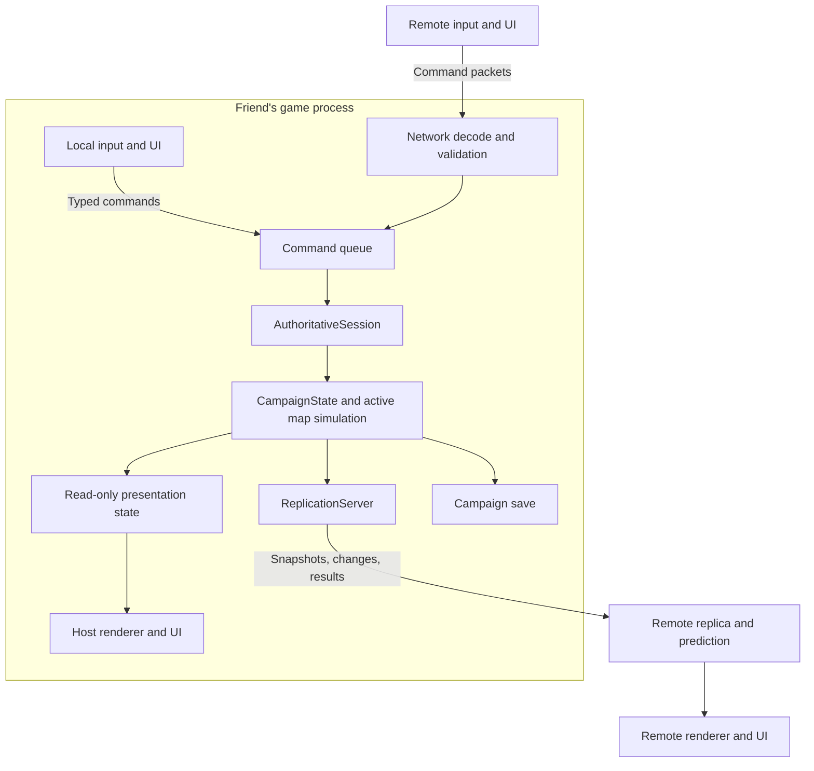
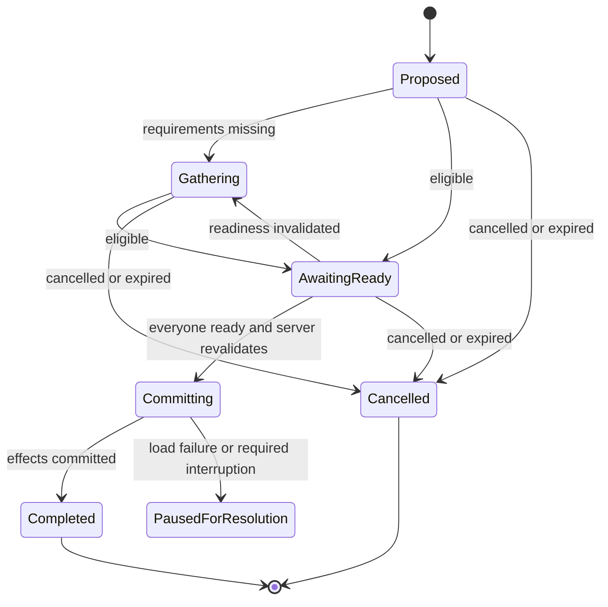

# Authoritative listen-server co-op architecture

Proposed design, based on the current working tree reviewed on 2026-09-27. Documentation only; implementation is
not started or authorized by this document. The recommendations below resolve the design questions for a first
release, but remain proposals for the user to review. They are not additional repository-wide instructions.
The [earlier investigation](MULTIPLAYER_ARCHITECTURE_INVESTIGATION.md) explains feasibility and the MMMerge comparison.
This document is the more specific implementation proposal; its decisions take precedence over that note's
preliminary suggestions when planning this feature.

**Build one authoritative campaign simulation inside the hosting friend's game.** Every human, including the host,
controls it through commands. The host runs monster AI, movement validation, damage, inventory, scripts, calendar
changes and saving. Friends run input, presentation, replicated state and local movement prediction. A later dedicated
server can run the same simulation without its local presentation; it is not required for this release.

Use one shared campaign and one active map. Normally each participant moves a separate group containing one or more
characters at one position: three friends with one character each have three groups; two friends with two characters
each have two groups. Characters within a group share its collision body and camera position. This movement model
is the working assumption, not an explicit answer to the earlier clarification. Separate bodies/following AI for
every character would require a revised design.

Target two to four participants and a maximum of five active characters in the expedition initially. Five matches
the current Party limit, not a claim that existing fixed arrays already support multiplayer. Keep character capacity
distinct from connection capacity. Independent positioning will change combat balance even with the same roster.
Ordinary single-player retains its pause, speed and turn-based behavior through the shared simulation.

**These are the recommended gameplay defaults.** The detailed rules and implementation contracts follow the table.

| Decision | Recommended behavior | Reason |
| --- | --- | --- |
| Authority | One host owns the campaign; clients request actions. | One result for damage, loot, quests and time. |
| Exploration | Groups move independently within one active map. | Provides useful co-op without concurrent-map simulation. |
| Map travel | Everyone travels together after readiness and destination validation. | Preserves one calendar, map runtime and story context. |
| Combat | Realtime co-op initially; existing single-player turn-based remains available. | Avoids introducing a multiplayer turn scheduler in the first slice. |
| Local menus | Inventory, spellbook, inspect and Escape menu leave the world running. | One person's UI cannot stop another person's battle. |
| Explicit pause | Any participant can pause immediately; resume after all connected participants are ready. | Appropriate emergency pause for a trusted group of friends. |
| Fast mode | Disable independent double-speed in co-op v1. | It currently scales simulation time, not just presentation. |
| Rest/wait | Shared proposal, safe gathering, unanimous readiness, one authoritative time advance. | Prevents unilateral healing or calendar jumps. |
| Training | One shared hall visit; batch requested levels into parallel rounds. | Preserves existing parallel training while avoiding several time jumps for one round. |
| Shops/temples | Local visits and server transactions; shared stock and gold. | Friends can use services concurrently without duplicating stock. |
| House safety | Only an accepted visit to a real house protects that group. | Preserves abstract house interiors without menu-based invulnerability. |
| Quests | Shared global QBits/story; explicit character reward and promotion recipients. | Campaign progress and personal advancement are different state. |
| Combat XP | Distribute one kill's XP once across the eligible active expedition roster. | Preserves the existing sharing rule; no last-hit competition or multiplication by connections. |
| Gold, bank, food | One expedition pool; costs charged once at the appropriate scope. | Closest fit to the existing campaign and party-sized service rules. |
| Inventory | Character ownership; other players cannot edit it without a transfer/authorization. | Keeps control clear while allowing trading. |
| Loot | Real shared items; one exclusive chest/corpse interaction at a time initially. | Simple race-free acquisition. |
| Party buffs | Apply to eligible nearby allied groups at cast time, with explicit per-spell exceptions. | A friend's cleric or mage remains useful to the expedition. |
| Friendly fire | Other player groups do not take ordinary allied attack damage. Authored self/campaign costs remain. | Cooperative default without silently removing a spell's intended cost. |
| Allied collision | Groups do not block one another; geometry and monster collision remain. | Avoids doorway grief and group-overlap correction problems. |
| Partial defeat | Other groups continue and can use existing recovery abilities. | One downed player does not end everyone's game. |
| Full defeat | Apply the existing campaign loss/recovery behavior once to the expedition. | One gold loss, death count and respawn operation. |
| Disconnect | Pause, preserve state, then reconnect, explicitly assign a proxy, or save/end. | No silent AI, inventory export or disappearance during combat. |
| Joining | Assign campaign characters; receive the host's current state. | Avoids merging incompatible personal save histories. |
| Saving/loading | Host writes the campaign; loading is a shared rollback and new session epoch. | Clients cannot overwrite authoritative progression. |
| Host departure | Save/end the session; no live host migration initially. | Keeps authority and recovery understandable. |

**The current source identifies concrete extraction points.** References use paths and symbols because the working
tree includes uncommitted changes; these findings are about that tree, not just the last Git commit.

| Source | Observed behavior | Required architectural change |
| --- | --- | --- |
| [GameSession](../../game/app/GameSession.h), `updateGameplay` in [GameSession.cpp](../../game/app/GameSession.cpp) | One Party, input frame, active world, UI, simulation services and transition. | Separate authoritative session state from each client's input/UI. |
| `renderFrame` in [GameApplication.cpp](../../game/app/GameApplication.cpp) | Gameplay and world updates occur inside rendering flow; modal/inspect/debug state gates updates. | One simulation update entry point independent of local rendering and overlays. |
| [EngineApplication.cpp](../../engine/EngineApplication.cpp) | Invalid drawable size skips the render callback. | Pump networking/session updates even without a drawable or focused window. |
| [Party.h](../../game/party/Party.h) | Characters, active selection, buffs, QBits, NPC changes, shop stock, resources and held-item queries coexist. | Move fields to their real owners; keep one canonical roster. |
| [IndoorPartyRuntime](../../game/indoor/IndoorPartyRuntime.h), [OutdoorPartyRuntime](../../game/outdoor/OutdoorPartyRuntime.h) | Both contain a Party value; scene/session paths copy Party state. | Movement runtimes reference a group and roster; remove duplicated authoritative Party values. |
| [GameplayRuntimeInterfaces](../../game/gameplay/GameplayRuntimeInterfaces.h) | Singular party access, simulation, rendering and interactions share an interface. | Separate simulation queries/mutations from local presentation, with explicit group context. |
| [Combat controller](../../game/gameplay/GameplayCombatController.cpp), [AI facts](../../game/gameplay/GameplayActorAiTypes.h), [projectiles](../../game/gameplay/GameplayProjectileService.h) | Party/member-index targets; some RNG depends on screen animation ticks. | Stable source/target identities; host-owned RNG and group-aware awareness/collision. |
| [PartySpellSystem.h](../../game/party/PartySpellSystem.h) | Requests contain indices, view transforms and privileged bypass/override fields. | Define a smaller public command; construct this internal request on the server. |
| [GameplayScreenRuntime.cpp](../../game/gameplay/GameplayScreenRuntime.cpp), [GameplayScreenController.cpp](../../game/gameplay/GameplayScreenController.cpp) | Rest consumes food and its UI animation advances calendar/timed states; completion can advance remaining time. | UI observes a server activity; one calendar owner performs the action. |
| `recordOeTrainingLevel`, `oeTrainingDurationMinutes`, service actions in [HouseInteraction.cpp](../../game/gameplay/HouseInteraction.cpp) | Calendar advances when maximum trained levels increases; visit counters are in dialogue state. | Shared authoritative TrainingVisit, independent of any client's dialogue window. |
| [TravelRuntime.cpp](../../game/gameplay/TravelRuntime.cpp), [HouseInteraction.cpp](../../game/gameplay/HouseInteraction.cpp) | Travel, training and prison directly mutate Party/time, sometimes before a pending map move. | Prepare/validate a coordinated activity before committing costs or transitions. |
| [EventRuntime.cpp](../../game/events/EventRuntime.cpp), [EventRuntime.h](../../game/events/EventRuntime.h) | Current/All resolve against one Party; single pending dialogue/prompt/map-move fields. | Explicit invocation subjects and per-interaction continuations; server-only authoritative script execution. |
| [ScriptedEventTimer.cpp](../../game/events/ScriptedEventTimer.cpp) | Legacy elapsed periods can be skipped rather than replayed; 256 legacy ticks per game minute. | Preserve timer semantics when centralizing time; no blanket catch-up loop. |
| [SaveGame.h](../../game/maps/SaveGame.h), [SaveGame.cpp](../../game/maps/SaveGame.cpp) | One party/position and held cursor item; writer opens destination directly. | Versioned campaign/group/item identities, consistent snapshots and atomic save replacement. |
| [ScenarioRuntimeDriver](../../game/scenario/ScenarioRuntimeDriver.cpp) | Headless tests drive the application and shared gameplay path. | Extend for several controllers and a simulated transport; do not maintain a separate test simulation. |

**The host process contains a server role and a local client role with one mutable simulation.** A remote client
does not construct another authority or run map scripts to decide gameplay. An offline game uses the same command
handlers with a local controller and no network work.

Suggested ownership and placement below describe real responsibilities. Introduce types incrementally, and move
existing behavior into them; do not retain duplicate owners behind forwarding adapters.

| Owner / suggested location | Owns | Must not own |
| --- | --- | --- |
| `GameSession` in `game/app/` | Session mode and composition: optional authority, local client and transport lifetime. | A second independent copy of gameplay Party/world state. |
| `AuthoritativeSession` in `game/session/` | Simulation scheduler, command execution, active map, activities, server interactions and publication. | SDL input state, windows, bgfx/audio handles or selected UI character. |
| `CampaignState` in `game/session/` | Campaign ID/ruleset, shared progress/resources/NPC/stock state, canonical roster, group records and inactive map saves. | Connection sockets and rendering state. |
| Revised `Party` in `game/party/` | Canonical active character roster and character operations; stable IDs through reserve/recruitment. | Global active UI selection, per-group movement, duplicated campaign registries. |
| `ControlledGroup` and existing movement runtimes | Character IDs, pose, movement/hazard state, house occupancy and group-effect references. | Copies of Character, inventory, shop stock or QBits. |
| Active indoor/outdoor simulation | Map actors/items/doors/projectiles/timers, spatial queries and collision for all groups. | A hardwired local camera or a privileged host party. |
| `LocalPlayerSession` in `game/session/` | Local selected character/group, UI, camera, input, replica/prediction and effect playback. | Authority to directly mutate simulation data. |
| `InteractionSession` in `game/gameplay/` | Actor/group/character context, live dialogue choices, continuation, target lease and revision. | One global dialogue slot shared by all clients. |
| `SessionActivityCoordinator` in `game/session/` | Pause, shared time activity, training visit and map/load barriers. | A second clock or copies of the campaign. |
| `ReplicationServer`, `ReplicationClient`, codec/transport in `game/network/` | Protocol, baselines, acknowledgements, bounded queues and transport. | Combat, loot or script rules. |

Keep gameplay under `game/` and engine facilities under `engine/`. The engine loop needs a general update callback;
it does not need knowledge of multiplayer quests or player ownership. Simulation data dependencies should come from
the existing shared data repository and explicit map context. Animation timings used by attack rules remain data
available to the simulation even when no renderer is attached.

Within Party, move `m_questBits`, global event/NPC overrides, reputations, uniqueness history, shop state and shared
currency/food into campaign-owned records. Move `m_activeMemberIndex` to the client; commands always name a character.
Move group buffs, fall/environment counters and monster target-selection context to group state. Character buffs
belong to the character's stable identity, not its temporary roster index. Replace `trainActiveMember`-style mutation
with explicitly addressed character operations. Move associated methods with the state; do not leave methods that
silently reach into an ambient "current party".

Keep immutable imported map geometry separate from mutable map state and per-client render caches. Clients load the
same collision/content assets locally, then apply the host's mutable state. Map timers, random drops, map-load event
effects and monster spawning run only on the authority. Refactor client map bootstrap accordingly; running today's
full scene initialization on each client could already execute authoritative work before the first network tick.

**Identify players, characters and objects independently.** A participant has a persisted campaign identity; a
connection is temporary. Characters and item instances receive stable IDs distinct from roster/template/item type
IDs. A participant normally controls one group; explicit proxy takeover may assign additional groups. Only one group
receives that client's movement controls at a time, and changing the controlled group clears held movement input.
Other groups keep their positions and remain in the simulation; proxy control does not create following AI.

| Identifier | Lifetime/use |
| --- | --- |
| `CampaignId`, `ParticipantId`, `CharacterId`, `GroupId`, `ItemInstanceId` | Persisted in the campaign; no reuse that can alias an old object. |
| `SessionEpoch` | Changes on host startup/load; rejects commands from an earlier run or rollback. |
| `MapEpoch` | Changes on map replacement/reload; rejects old-map commands and replicas. |
| `ControlRevision` | Changes on assignment/takeover and when input is re-enabled after pause/activity; invalidates old inputs/actions. |
| `EntityRef` | Map identity/epoch plus object kind, ID and spawn generation; static map references resolve against matched assets. |
| `CommandId`, `InteractionId`, `ActivityId`, state revision | Request de-duplication, continuation scope and ordering. |

Never accept a participant identity merely because a packet claims it: associate it with the established connection.
Internal vector indices can remain implementation details, but are resolved from stable IDs at command execution.
Persist allocation counters and preserve item identity through inventory/equipment/world/container transfers. Splitting
a stack creates a new instance; merging retires one ID. Replica deletion must prevent a late packet resurrecting it.

**Run one simulation update path independently of presentation.** Start with a single writer on the game thread.
Networking callbacks enqueue decoded, bounded requests; they do not mutate Party, Lua or map state. This avoids
introducing concurrent access into the current runtimes. Add/update an engine callback that runs before drawable-size
and rendering early exits, and let `GameApplication` pump its session there. Menus, host inspection, a minimized
window and local video/UI must not accidentally stop the server.

Use fixed simulation steps, initially testing 60 Hz and 20 Hz state publication as tuning targets, not established
performance budgets. Retain existing subsystem cadences/physics substeps where their behavior depends on them.
The proposed tick order is: drain lifecycle/input; advance running-time/recovery; update mechanisms; move groups;
resolve spatial triggers and addressed player actions; update the union of active monsters once; advance projectiles
and resolve impacts; resolve resulting events/defeat/activities; publish a consistent revision. Extraction must account
for all work currently split between `GameSession::updateGameplay`, `GameApplication::renderFrame`, scene simulation
and world updates, so no timer or world gets stepped twice.

Bound catch-up work and report host overload. Under sustained overload, slow the authoritative simulation together
rather than taking a huge physics step or advancing the calendar independently. OS suspend is a session interruption,
not hours of game-time catch-up; discard old held inputs and resynchronize or reconnect on resume. This design removes
UI-driven pauses but cannot make a suspended host available. Android client lifecycle and release performance require
validation; do not promise dependable background phone hosting. A separate simulation thread is an optional later
optimization after ownership and immutable publication are proven.

**Use a narrow command boundary.** Example payloads are movement/aim input for a group, Attack with a character and
target, CastSpell with a character/spell/target, Interact with a world reference, MoveItem with source/destination
and expected container revision, ChooseDialogue with interaction/choice revision, and activity propose/ready/cancel.
The server validates control, map, current target, range/LOS, recovery, resources and interaction state. The local
host goes through the same handler and queue without network serialization or artificial latency.

Do not serialize `GameplayInputFrame` or expose `PartySpellCastRequest` directly. Fields such as `spendMana`, mastery
overrides, bypass flags, authoritative positions, arbitrary map destinations and preview pixels are not client
authority. Build the internal request from validated character state, spell definitions and the actor's group pose.
An interaction command names an interactable; the server resolves its event. Do not expose arbitrary event execution,
Lua evaluation, save-file writes or debug-console commands as gameplay RPCs.

Execute finite action commands once, in recorded server order, with per-participant limits; a client's suggested
tick is not permission to backdate an item pickup or spell. Movement is a sequenced input stream. Hold the newest
valid state only for a bounded input gap, then neutralize it; packet loss must not leave a player running indefinitely.
Every discrete result includes its command ID and resulting revision. A retry returns the original result instead
of repeating the mutation. This is application-level de-duplication in addition to transport reliability.

**One campaign clock serves all groups.** Separate network/wall time, fixed simulation steps and calendar time.
Store the authoritative calendar as signed 64-bit legacy time ticks plus a fractional step accumulator; the existing
conversion is 256 ticks per game minute. This keeps saved/script time exact at its native resolution. Convert to
legacy float/double API units at explicit boundaries during migration, not in every client's clock.

The inspected realtime paths use 0.5 game minutes per real second. Preserve that rate; do not multiply it by the
number of groups or update it in both scene and session. Character recovery/physics use their existing simulation-time
units; buffs, ageing, day changes and timed items use their documented calendar units. A shared context supplies the
clock to world queries. Move combat RNG off UI animation ticks and preserve its state in campaign/map snapshots.

Introduce one `advanceCalendar` operation with a reason and addressed participants. It owns normal time and large
jumps and invokes daily counters, timed character/item effects, weather/schedules and event timers exactly once at
the appropriate scope. Preserve existing action-specific ordering: rest currently advances then heals; training
commits its level/cost, performs round recovery, then advances time. Route and overland travel have their own tested
food/recovery ordering. Unifying ownership must not silently homogenize those rules.

For a large calendar jump, do not run days of physics or blindly replay every missed timer. Preserve the existing
legacy timer coalescing rules and `ScriptedEventTimerTests`; native periodic behavior uses its declared semantics.
Inactive map snapshots remain inactive and reconcile visit/refill state when loaded. Their timestamps refer to the
same campaign clock. A client never executes timer callbacks to "catch up" independently.

**Shared activities use one coordinator with explicit readiness and commit boundaries.** Any participant can propose
rest, waiting, training, route travel, a teleport or a prison sentence. The host computes the affected roster, location
requirements, duration rule, costs and consequences. The proposal is visible to everyone; the world keeps running
until commitment. Readiness is unanimous among the current controllers, including players whose characters are
incapacitated. Spectating a conversation does not count as accepting a shared operation.

An activity contains its ID/revision, type, initiator, required controllers/groups, requested parameters, quoted cost,
consents and phase. Any change to participants, destination, level requests or material price invalidates approvals.
Normal calendar movement alone must not reset every vote: consent covers a duration/finish rule and cost ceiling,
not an ever-changing displayed countdown. Revalidate service opening/schedule and cost at commit, and renew consent
if the meaningful offer changes. A timeout cancels; silence is never readiness. Start with one shared activity at a
time. Locks/resource reservations become binding only at final validation/commit, or must be released on cancellation.

Before commit, movement away, a new hazard, combat, invalid service access or disconnect invalidates readiness.
Once committing, reject unrelated world mutation commands and process only that activity/lifecycle control. Clients
cannot cancel an already-applied rest or level-up by closing the window. Pure service/item operations commit bounded
write sets on the simulation thread. Script execution still follows its explicit checkpoints; this is not a generic
rollback engine for arbitrary Lua. On a script fault, pause with a recorded failure instead of automatically replaying
possibly completed rewards. Network disconnection cannot leave half an item transfer or half a training round.

**Pause and rest need distinct behavior.** A manual Pause command freezes simulation/calendar at a tick boundary,
while networking, UI, saving and readiness messages remain available. Anyone can request it; resuming requires every
connected controller's ready state. Host administrative override is explicit and visible, not triggered by closing
the host's menu. Pause permits inspection and planning, not combat, shop, inventory or spell mutations; pending
uncommitted actions are cleared/revalidated on resume. Clearing pause never clears a map-load or disconnect barrier.

Readiness is one vote per controlling participant, regardless of character/group count. A shared activity proposed
while paused may execute only after unanimous approval of that activity; retain the previous pause on completion
unless everyone also agreed to resume. Administrative resume is not consent to a purchase, time jump or travel.
Rotate the control revision when gameplay input is enabled again so delayed pre-pause actions cannot execute later.

For outdoor/dungeon rest, require all groups at a common camp point, grounded, in permitted terrain, without nearby
hostiles or active damaging hazards. Evaluate the existing rest restriction against every group, not just the host.
Require reachable proximity, not merely closeness through a wall. Initially tune the gathering radius around 1024
map units and validate it visually on indoor/outdoor maps; store it as a co-op ruleset parameter.

Heal-rest advances eight hours as the existing action does. Calculate map food cost, RestFoodCost hooks and applicable
follower reductions once for the gathered expedition, then debit the common pool once. Refuse if food is insufficient.
Use the existing recovery semantics: ordinary rest is not resurrection and does not erase every condition. Inn rest
requires all groups at the same actual inn; charge the current party-sized room quote once, omit camping food, and
apply existing inn recovery/map-reentry effects once. Waiting five minutes, one hour or until dawn uses the same
safe-gathering/readiness mechanism but does not grant full rest recovery or consume heal-rest food.

The authority completes the time action; the hourglass is just presentation. Escape may dismiss a client's completed
animation, but never call today's "advance all remaining minutes" behavior on the shared campaign. Safety is checked
again immediately before commitment. After commitment, any due scripted combat/transition is resolved by the server
before returning control. Do not add a new random-ambush system as part of networking. If future interruptible camping
is desired, define partial-rest costs/healing separately rather than pretending a committed jump can be cancelled.

**Training should be a shared hall visit with parallel rounds.** All groups gather at the same training hall. Each
controller selects target levels for their characters; everyone else chooses to wait. The server quotes each level's
current eligibility and price using existing class/XP/house/merchant rules. Apply the active character/group's proper
service skills explicitly; shared consent is not permission to borrow a remote character's skills implicitly.

For requested level increments `n[c]`, the visit needs `max(n[c])` rounds. Round r trains each character with at least
r requested levels once and charges only those individual level fees. One calendar advance is charged per round.
For example, A training two levels and B training one costs three level fees and two time advances, not three.
This follows `recordOeTrainingLevel`, already covered by the parallel-training regression test.

Retain `oeTrainingDurationMinutes`: each round uses seven days plus time until the next dawn plus four hours, and
the current special halls add another twelve hours. Compute each successive round from its resulting calendar time;
do not replace this with an assumed flat seven days or multiply one initial duration. Move visit counters out of
`EventRuntimeState::dialogueState` into an authoritative TrainingVisit keyed by hall and character ID. Closing or
reopening a client's dialogue cannot reset a committed round or create another calendar charge.

The current training helper uses 05:00 as its dawn boundary, whereas the rest UI's Wait Until Dawn uses 06:00.
Preserve these distinct service rules during extraction. The existing ordinary-hall regression expects subsequent
training rounds to advance eight days; this is why a generic seven-day replacement would change gameplay.

Commit a round's current level/cost/recovery/time behavior once. Revalidate subsequent rounds after any calendar or
script consequence; cancel unstarted rounds if eligibility changes, preserving completed rounds and their costs.
Nontraining characters experience the shared passage of time and existing round recovery. Initial implementation
can offer a single round per approval before adding the multi-level planner, but all characters in that round must
already share its time cost. Basic skill purchases or mastery lessons that currently take no calendar time remain
ordinary individual transactions; they do not inherit a week-long training delay just because they are services.

Maintain cumulative `trainedThisVisit[CharacterId]` and `paidRounds` for the fixed cohort present when the visit opens.
An extension requires `max(0, max(trainedThisVisit[c] + requested[c]) - paidRounds)` additional time rounds. An original
cohort character catching up within already-paid rounds still pays every level fee but does not advance time or
trigger another expedition-wide round recovery. Newly admitted characters cannot consume old cohort entitlements;
finish the existing visit and start a new cohort before they train. The shared visit ends when any cohort group leaves
the hall; merely changing a dialogue panel does not end it. Persist the cohort/counters when saving inside the visit;
do not accidentally change training prices/time by losing transient UI state.

**Map changes are shared transactions with a load barrier.** For an ordinary exit, all groups gather at the same
reachable exit/transport location. A teleport gathers them around the caster; its eligibility and destination are
validated from authoritative spell/quest state. A paid boat/stable route uses the server's current schedule, discounts
and one expedition fare. Show destination, elapsed days, resource costs and applicable restrictions before readiness.
No one pays, heals or advances time merely by proposing a route.

The transition sequence is:

1. Revalidate readiness, proximity, destination, spell/service restrictions and resources. Freeze at a tick boundary,
   clear movement input and close/release transient chest/dialogue leases. Preserve authoritative cursor items.
2. Capture a recoverable source checkpoint including campaign, outgoing map, all groups, timers, RNG and escrow.
   Validate/load destination content on the host and have clients prepare their matching assets. Keep transport/UI
   pumping during loading; clients report readiness for a specific transition ID, never for "whatever map is current".
3. Execute source leave hooks and apply the quoted action's costs/time/side effects once on the authority. Construct
   the destination state, run load/entry hooks once, and place every group on valid destination floors. No client
   executes these hooks. Stage presentation until the authoritative transition succeeds.
4. Commit the destination and new MapEpoch, publish the full destination baseline and wait for each admitted client
   to acknowledge applying it. Readiness includes collision/world-state readiness, not only a finished loading image.
5. Resume with cleared stale inputs and a common authoritative tick. Each client retains its group and selected
   owned character. Group positions may use a validated arrival formation; no client chooses an arbitrary spawn.

If the host cannot prepare/commit the destination, restore the source checkpoint and report failure without losing
resources. This is an explicit failed-transition recovery path. After host commitment, a client load failure keeps
the destination paused: retry that client or resolve its disconnect/ownership, without replaying leave/load hooks.
No silent timeout counts a failed client as ready. Host crash recovery uses the last completed checkpoint; do not
promise that unsaved commands survive a crash. Leave the pre-transition checkpoint available until a destination save
has committed. Do not take a misleading autosave containing old-map positions with new-map costs.

Same-map teleports can be group-local when the event/spell says so, and do not require replacing the whole map.
Authored forced cross-map events need explicit policy: an expedition-wide trap/story transition can force everyone
through the barrier without a voluntary travel vote. An originally local transition whose co-op scope is ambiguous
needs a content overlay/annotation before that content is supported. Do not make all map-changing EVT operations
silently target the host, or insert consent into a forced story consequence and deadlock its script.

Serving a prison sentence is another shared proposal, with the existing one-year duration and fine/award/recovery
effects quoted visibly. One player's service click cannot age the campaign a year immediately. Other scripted
calendar jumps use the same reasoned clock path; forced narrative time changes carry an explicit expedition scope.

**Combat targets groups and characters explicitly.** Reuse existing movement/collision and shared AI/combat formulas.
Build monster activation from the union of groups' relevant regions and deduplicate it; a monster near a distant
client remains simulated even if the host cannot see it. Generalize target facts from the singular Party to a
Group/Character reference. Select the target group using awareness, range, LOS, hostility and invisibility, then
apply existing character preference rules within that group's members. Never pick a victim from another group merely
because its character occupies the same roster index.

Melee originates at the attacking group's authoritative pose/aim. Projectiles retain caster CharacterId, source
GroupId, summon ownership and map epoch through impact. Area attacks test all applicable group bodies and characters;
the current `affectsAllParty` flag must become a declared affected scope rather than damaging the entire expedition
at arbitrary distances. Preserve source attribution for reflection, XP, conditions and quest hooks. Evaluate monster
bolstering from the intended expedition roster once under existing spawn/load rules; connections and client joins
must not multiply enemies or reroll their state.

Each character's readiness/recovery remains separate. A client may act only with a controlled, eligible character;
switching selection does not bypass recovery. Keep combat RNG state on the authority and emit final outcomes. Remote
animation/particles are consequences of those outcomes. Prediction can show an immediate cast gesture or provisional
projectile, but must reconcile/reject it and must never grant predicted damage, loot or quest progress.

**Spells need a small, explicit co-op scope table.** This refines the earlier investigation's group-only buff default.
Preserve existing spell strength, mana costs, eligibility and duration except for declared recipient/scope changes.

| Spell category | Proposed recipient rule |
| --- | --- |
| Single-character healing, curing, buffs | Owned or allied CharacterId; another group's target requires range and LOS. |
| Ordinary party-wide buffs and recovery | Caster's group plus eligible nearby allied groups at cast time; recipients are server-selected and recorded. |
| Fly and Water Walk | Grant eligible nearby groups their movement entitlement for the normal duration; leaving the caster's radius does not itself cancel it. |
| Invisibility and similar action-broken effects | Apply to eligible groups; breaking behavior is scoped to the acting/affected group under that effect's rule. |
| Immolation and other source-centered damage | One source effect at its caster/group, with ordinary spatial damage checks; do not duplicate damaging emitters for every buff recipient. |
| Jump / local movement impulse | Acting group only unless that spell's explicit definition says otherwise. |
| Shared Life / pooled-resource spells | One calculation over the explicitly selected eligible nearby characters, using existing formula/condition rules. |
| Town Portal, Beacon recall, cross-map travel abilities | Agreed expedition travel; charge mana/recovery on successful commitment, not on opening the destination UI. |
| Beacon creation | Owned by the casting character, saved on the host; preview imagery is local presentation. |
| Telekinesis, enchanting, item-target spells | Validate target, ownership, distance and container revision; use the same loot/item transaction rules. |
| Map-wide destructive spells | Preserve authored world effects and declared expedition/self costs; audit separately from ordinary friendly fire. |

Initially use a configurable aid radius around 1024 map units with LOS for cross-group recipients; measure playability
before freezing that value. Party buffs are finite grants at cast time, not invisible network auras. Effects with
ongoing costs track one authoritative originating cast/caster and charge its upkeep once under the spell's rules,
not once per replicated recipient. Define caster death, resource exhaustion, dispel and expiry per effect. Splitting
or merging a group at a safe boundary must not duplicate duration, charges or damaging effects.

The normal HUD can still show the five expedition portraits with ownership markings. Clicking one's own character
selects it; a friend's portrait is a target during spell targeting and otherwise opens read-only inspection. A remote
two-character group's billboard opens member targeting where necessary. Reuse creature sprite assets for visual
representation, but give the player group its own entity type, collision/selection and animation state. It must not
participate in monster kill counts, random loot or monster-AI updates.

**Inventory and services use authoritative transactions.** Shared resources and stock have one campaign owner.
Characters retain their own equipment/inventory; the controller may inspect other characters but cannot rearrange
their ordinary possessions without authorization. A trade has explicit sender/recipient acceptance, validated item
instances and space, then one atomic ownership change. Simultaneous spending cannot take the common gold balance
below zero. A rejected stale purchase refreshes the offer; it does not charge money or regenerate stock.

Use a server-owned cursor escrow per participant, associated with the relevant character/group. This preserves the
existing ability to carry an item on the cursor while giving that item an authoritative location. Begin-drag atomically
moves the item into escrow; placement/drop/use atomically moves or consumes it. A swap moves the displaced item into
the same escrow. Failure leaves it there. Client UI draws a projection and never owns the only copy. On disconnect,
put it in an owned character's inventory if possible, otherwise keep the persisted escrow; do not silently drop or
delete it. Legacy held-item saves migrate explicitly into this storage. Include escrow in correctly scoped quest
item checks and unique-item accounting.

Chests and corpses start with one interaction lease, released on close, invalid distance, transition or disconnect.
Loot rolls, trap outcomes and contents are generated once by the host. An item can be taken only from the current
container revision. Opening the chest does not pause the world or make its user invulnerable. The lease grants
interaction access, not ownership of all contents after it closes. Ordinary dropped items remain shared world items
with stable IDs and authoritative positions.

House visits are server state entered by a valid house interaction, with the existing opening/entry restrictions and
an explicit combat eligibility check. Do not require all groups to enter for ordinary shopping. Inside the abstract
house, that group is unavailable as a world combat target and cannot attack/cast into the map. Others continue playing.
Exit restores it at a valid entrance pose. Shop/temple effects target explicitly selected eligible characters present
for the service. An inventory screen opened outdoors never creates house safety. Shared time services require the
whole expedition's activity protocol even when initiated from a protected house.

Follower contracts/uniqueness and wages belong to the campaign. Attach a follower's local exploration benefits to
an explicit group; aggregate supported travel/rest discounts once for a gathered expedition. This avoids multiplying
one hired follower's effects by connections. Service skill selection must name the contributing character/group;
there is no invisible borrowing of a distant teammate's Merchant, Disarm Trap or item skill.

**Scripts execute once, with explicit context and recipients.** Introduce an invocation context carrying participant,
acting GroupId/CharacterId, interaction ID, map identity and trigger cause. Current resolves to that invocation's
character. All resolves to a declared scope: acting group for a local fountain/hazard, eligible expedition characters
for a shared quest reward, or campaign state for a global operation. Map timers/load hooks have no human initiator;
they must not fall back to the host's selected character. Numeric legacy character selectors require an explicit
mapping for that invocation, not a client-provided roster index.

Each conversation owns its continuation/prompt and offered choice revision. Only its controller chooses topics; other
players may observe. Two different NPC conversations may coexist, while conflicting changes serialize on the host.
A second conversation revalidates a quest choice after the first changes its prerequisites. Same-NPC quest dialogue
can use a single lease initially. Suspended prompts/responses are addressed to the right interaction, including MM9's
existing compiled dialogue hooks; do not introduce a general SCR runtime for multiplayer.

Keep global QBits/journal/NPC state in the merged campaign scope. Combat XP is split once across the eligible active
roster using current `grantSharedExperience` semantics, even if groups explored different parts of the same map.
Scripted XP/rewards retain their source meaning: an amount granted to each selected character is not automatically
converted into a pooled kill reward. Personal skill/class/promotion effects remain personal and check eligibility.

Use command de-duplication for retries and existing quest predicates for normal once-only content. Add persisted
per-character claim records only where a shared quest stage would otherwise lose an eligible absent/later character's
personal reward or promotion. A claim key needs canonical source, stage/reward and character identity; repeatable
content additionally needs its repeat/respawn cycle. Do not globally deduplicate by raw event ID or make every
repeatable fountain a one-use event. Existing promotion sidecar behavior for later recruits should be retained.

Expedition-scoped key/item requirements can see accessible active-roster inventories and their escrow, consuming the
single required instance as a declared shared quest action and notifying its owner. Ordinary equipment/item services
retain individual ownership rules. Campaign gold and unique quest objects are awarded once; reconnecting cannot
repeat them. New recruits do not automatically receive all past XP/gold. Returning participants reclaim the same
characters, whose progress continued only if the expedition explicitly used a proxy or other agreed absence policy.

Resolve ambiguous legacy event scopes in a small content policy/overlay keyed by canonical world/script/event and
operation, or fix the exporter where the meaning is general. Do not patch generated Lua directly or scatter map-name
exceptions into multiplayer code. Global/map variables and event mutations have one authoritative owner; clients
receive outcomes and addressed UI/audio events instead of replaying the script. Quests, traps, promotions, conditional
dialogues and forced transitions need a content acceptance inventory before advertising complete campaign support.

**Death, minigames and absence must not depend on the host's screen.** A group with no actable character stays in
the world and can receive existing healing/resurrection effects where the conditions permit. Its controller may
observe and participate in readiness, but cannot act through a disabled character. Only an expedition with no actable
active character triggers the existing defeat consequences: one carried-gold loss, death-counter change and configured
respawn. Keep the bank and other semantics as current rules specify. Execute recovery before/independently of any
client finishing its loss video.

If a surviving expedition cannot recover a defeated group, provide unanimous "retreat and recover" using the same
whole-expedition defeat penalty/respawn. This is an explicit co-op convenience; it avoids inventing free resurrection
or leaving the campaign permanently stuck. Ordinary voluntary map travel still requires the gathering rule unless
an explicitly supported rescue mechanic is added later. Do not silently teleport a stranded body on every exit.

Story cutscenes that gate campaign progression create a shared pause/acknowledgement barrier. Skipping locally marks
that participant ready but does not advance the story twice. Arcomage has its own server-owned match state and AI/RNG
for the interacting player, with the others continuing normally; its turn-based card rules do not activate world
turn-based combat. A client's "I won" message is never sufficient for a reward. Extract its existing pure game rules
from screen lifecycle rather than reproduce them in network code. If this support is deferred, affected quest chains
must remain explicitly outside the supported content list; disabling the UI alone is not full campaign support.

On a lost connection, neutralize input and pause the campaign. Preserve the group's pose, characters, items and effects.
The host can wait, save/end, or explicitly assign proxy control to a remaining participant. Proxy control supports
switching between owned groups; their bodies remain where they were and inactive controls are neutral. Merging groups
requires a safe reachable gathering, not teleporting characters out of a battle. A returned connection must acquire
a fresh control revision before input is accepted. Release interaction leases at defined command/script checkpoints;
do not automatically replay a lost dialogue choice or delete its already-committed effects.

Do not silently start progressing an absent friend's characters. At session start, show character assignments and
any proxy arrangement; friends can agree to continue in that form. No unattended simulation or real-world elapsed
calendar advancement is part of a listen-server campaign. Host departure ends it for everyone. A transferred stopped
campaign save can later be hosted by another friend; importing it creates a fresh session identity/authentication
context. Automatic live host migration and independent save merging are deferred.

**Replication separates durable state from frequently changing poses.** The server publishes a coherent tick/revision.
Clients do not write replicated state into the authority. Host presentation uses the same read-only field model and
can read an immutable local projection without encoding packets or copying a full map every frame. Offline mode
allocates no transport, connection baselines or network publication work.

| Message class | Contract |
| --- | --- |
| Handshake/admission | Version, build/ruleset, ordered gameplay-content fingerprints, participant proof and assigned control. Reject mismatches before simulation admission. |
| Movement inputs | Sequenced, redundant recent samples/acknowledgements; reject wrong epochs/control, stale samples and invalid values. |
| Discrete commands/results | Reliable, bounded, ID-addressed; retry-safe mutation and explicit rejection reasons. |
| Pose/velocity/animation snapshots | Unreliable sequenced; newest applicable tick wins, with periodic recovery baselines. |
| Spawn/despawn, health, inventory, quest and interaction changes | Reliable revisioned changes; baseline/snapshot installation cannot overwrite newer committed state. |
| Join/map baseline | Bounded chunked transfer with integrity checks and a known revision; buffer/replay subsequent changes or restart the baseline if the buffer limit is exceeded. |
| Sound/FX/UI events | Identified, scoped presentation messages; critical UI/reward results are reliable, disposable cosmetic effects may be dropped. |

Use explicit widths/enums/lengths and bounded decoding; never send C++ object layouts or pointer values. Reject NaN/
infinite coordinates and oversized inputs before simulation access. A state revision or deleted-entity generation
prevents late traffic reviving an item/monster. Keep large baseline traffic on a separate priority lane so it does not
block gameplay commands. The server's acceptance order resolves item/stock races; receiving a fresh transform does
not authorize a stale command against an earlier inventory revision.

Initially replicate active-map state to this small trusted group, including changes near remote players. Do not use
the host camera's visibility to decide what is simulated or exists for replication. Add measured spatial relevance
for high-volume actor/FX updates if needed, while always delivering campaign state and each client's relevant entities.
Measure a large map with groups separated; do not infer bandwidth/CPU budgets from one local camera.

Predict only the controlled group's movement using shared collision/movement code. On an authoritative snapshot,
restore its acknowledged movement state and replay unacknowledged inputs, then smooth the visual error. The state must
include movement modes, velocity, support/sector and relevant mechanism revision; position alone is insufficient for
flying, jumping and moving platforms. Predictions never execute script triggers, grant items or advance campaign time.
Interpolate other groups/monsters between server samples, with bounded extrapolation and reset on teleports/map epochs.
An initial interpolation window around 100 ms is a measurement target, not a fixed gameplay requirement. Avoid full
world rollback or shooter-style lag compensation initially; range/LOS and combat resolve at the server's current tick.

**Joining is admission to the existing campaign, not loading a private character save.** The sequence is connect and
authenticate/approve, check protocol/content, select an available campaign assignment, load static map assets without
authoritative hooks, install baseline and subsequent changes, acknowledge ready, then accept gameplay input. A new
participant's group is activated at a safe rendezvous; existing characters keep their location on reconnect. A person
can connect and wait during combat without spawning an invulnerable helper or freezing everyone immediately.
Admission readiness and world activation are separate states.

Give returning participants an authenticated reconnect credential tied to campaign identity; keep it out of replicated
game state. Allow host-approved reassignment if a friend loses that credential. Never identify ownership by display
name or IP address alone. Reject obsolete session/control epochs and rebuild replicas on reconnect. Unknown command
outcomes are resolved against the server's state/result cache; the client does not blindly resend every past action.
Spectators, public accounts and matchmaking are not required for this friends-only design.

**Use a maintained transport and keep connection services outside gameplay authority.** Recommend a pinned revision
of [GameNetworkingSockets](https://github.com/ValveSoftware/GameNetworkingSockets) for the first integration: it offers
reliable/unreliable messages, encryption and network-condition testing, while game serialization/replication remains
our responsibility. Prove its build and packaging on the intended desktop and Android targets in an early transport
spike before committing to the dependency. No transport build was attempted in this documentation task.

First validate loopback/direct LAN connections. For friendly internet invitations, plan a small authenticated signaling
service plus STUN and TURN relay capacity; a short invite resolves an approved session and connection metadata. The
relay carries transport traffic, while the friend's process remains the game authority. The upstream
[P2P documentation](https://github.com/ValveSoftware/GameNetworkingSockets/blob/master/README_P2P.md) describes signaling,
STUN and relay requirements. Pin and test the selected implementation's TURN path; do not assume every old library
revision supports the same route. Steam relay access is not bundled with the open-source library.

Direct LAN/address entry should remain usable if an optional rendezvous service is down. Do not claim arbitrary
internet Host/Join is finished after a localhost demo. A relay operator/deployment and target-platform validation
remain delivery choices to settle during that spike; neither requires a hosted authoritative world or public accounts.
Use transport cryptography and authenticated admission rather than designing another encryption protocol.

**Version the save around authoritative state and make writes atomic.** Extend the current versioned format rather
than turning network snapshots into the disk format. Persist campaign/ruleset/content requirements, canonical roster
and item IDs, groups/poses/movement/effects, shared progress/resources/stock, map state, timers/RNG, cursor escrow,
character assignments, relevant reward claims and ongoing training-visit counters. Presentation preferences and
preview images can remain local metadata; live sockets, replication baselines and client screen objects are not
authoritative campaign state.

Capture one consistent state at a simulation boundary. Freeze or close interactions at a declared checkpoint, and
persist any actual escrow item before closing its UI. For v1, defer a manual save during an in-flight map/activity
commit or unsupported script continuation until a stable boundary; ordinary combat can be saved where the existing
map rules allow it, with projectiles/effects/timers included. Host can save; clients can request it. Show completion
only after a successful write.

The current `saveGameDataToPath` writes directly to the destination. Replace that path in a future implementation
with a sibling temporary file, verified write/close, platform-appropriate durable flush/atomic replacement, and a
retained last-good checkpoint. Serialization may happen from an immutable captured snapshot without leaving the
simulation paused for disk I/O. Do not overwrite the only good save if serialization or disk writing fails.

Migrate a single-player save explicitly into a new co-op campaign copy: create stable IDs, one initial group, canonical
map/time state and authoritative cursor escrow, then assign/split groups at a safe lobby/rendezvous. Preserve the
original save and reject unsupported future schemas/content mismatches clearly. No heuristic merging of different
players' QBits or inventories. A normal load requires shared readiness, ends/replaces the old session epoch and
distributes a fresh baseline. Discard transient command de-duplication caches on that epoch change; persist actual
reward/claim state. Unsaved progress rolls back consistently for all players, never just one client's character.

**Feasibility and effort: viable with the existing engine, with a substantial shared-gameplay refactor.** The source
audit found useful implementation boundaries and no architectural requirement to replace the engine. That is a design
assessment, not a demonstrated multiplayer result: no two-controller prototype, transport integration or performance
measurement has been completed. Confidence in the direction is higher than confidence in the delivery estimate.

| Area | Expected amount of replacement/rework |
| --- | --- |
| Renderer, audio/video, asset formats, imported maps and data | Broad reuse; add remote-group presentation and remove simulation dependencies on presentation. |
| Collision/movement algorithms, combat formulas and character rules | Broad reuse of calculations; change callers, state ownership and explicit source/target context. |
| Party, GameSession, scene/PartyRuntime ownership, application update loop | Substantial structural refactoring. Canonical characters, multiple group bodies and separate UI state are the main foundation work. |
| AI targeting, projectiles, buffs and interactions | Significant integration changes across shared systems to support several independently positioned groups. |
| Events/dialogues, time services, map transitions and saves | Substantial coordination/state changes plus content-specific validation; likely the largest uncertainty. |
| Protocol, replication, prediction, admission/reconnect and shared-activity UI | Mostly new implementation using the existing gameplay systems behind commands. |

The scope is too cross-cutting for an honest percentage of "the engine rewritten" from this audit. Much of the work
changes who owns state and who can call an existing operation; the underlying operation often survives. A small number
of central abstractions have many callers. File size or the number of changed lines would be a poor proxy for effort.

For planning, use the following rough cumulative ranges for one experienced full-time developer familiar with this
codebase, including focused regression work. They assume desktop first, realtime, one active map, existing billboard
art and the proposed small roster. They exclude concurrent maps, live host migration and cooperative turn-based
combat. These are judgment estimates, not measured productivity or a commitment; do not add the rows together.

| Milestone | Approximate cumulative effort | What it establishes |
| --- | --- | --- |
| Two local controllers on one authoritative map | 4–8 engineer-weeks | Canonical ownership, independent movement, representative combat/healing and local UI separation. |
| Restricted LAN co-op prototype | 8–14 engineer-weeks | Two processes can move, fight, loot and make a basic shared map transition; selected content only. |
| Usable private desktop alpha | 16–28 engineer-weeks | A declared campaign subset, shared services/time, reliable item handling, save/load and reconnect. |
| Dependable release with broad MM6/MM7/MM8 campaign coverage | 6–12+ engineer-months | Internet joining, failure handling, content edge cases, solo regressions and sustained multiplayer playtesting. |

The first foundation milestone should replace these estimates with measured effort and a call-site/content inventory.
Broad campaign support has an open-ended tail: legacy event recipient scopes, promotions, forced transitions and
unusual spells can expose assumptions beyond the inspected examples. Cross-platform/Android support needs its own
packaging, lifecycle and performance allowance. AI-assisted editing may shorten mechanical changes, but this audit
does not establish an agent-hours conversion or remove the need for multiplayer playtesting.

The expensive scope choice is independently positioned groups. Supporting three people rather than two, or letting
one person control two characters in a group, should be a smaller increment once ownership/group context is correct.
A dedicated server would still require that same foundation, plus unattended startup/lifecycle work. One active map
and one shared clock keep the first release tractable. CPU and bandwidth remain unmeasured, especially when separated
groups activate more monsters than a single camera currently does.

Before full multiplayer work, useful incremental preparation is to establish canonical Party ownership, separate the
simulation update from rendering, and give actions an explicit acting character/group. Complete each with preserved
single-player behavior; avoid speculative network scaffolding throughout the codebase. The first multiplayer gate
should then be the two-controller proof, followed by a revised schedule before committing to broad content support.

**Implementation should proceed in slices that expose ownership problems before network complexity.** The following
are proposed changes and acceptance gates, not completed work. New type/file names are suggestions within existing
subsystem layers, not a requirement to build all abstractions at once.

| Slice | Concrete source work | Acceptance gate |
| --- | --- | --- |
| A. Contract and transport feasibility | Freeze co-op ruleset/IDs; prototype the selected transport's build, direct connection and relay path separately from game integration. | Platform/dependency feasibility known; no game state assumed synchronized. |
| B. Canonical state ownership | Refactor Party, both PartyRuntime classes, GameSession, scene snapshots and SaveGame; explicit character/group context and migration. | One character/item owner; old saves preserved; solo actions and save round trips retain behavior. |
| C. Simulation entry point | Extract AuthoritativeSession and local client; move updates out of renderFrame, move time/RNG off UI, split world simulation/presentation interfaces. | Headless and desktop use the same runner; a host menu/minimized window does not gate it. |
| D. Two local controllers | Drive two groups with commands in one process; extend AI, collision, combat, spells, triggers and client selection. | Independent movement, cross-group healing and combat away from the first camera work without sockets. |
| E. Co-op activities/content | Activity coordinator, calendar owner, training visits, interaction contexts, inventory escrow, map barriers and event scope policies. | Rest/training/time, loot races, representative quests and forced travel have consistent results. |
| F. Network vertical slice | Wire command codec, authoritative snapshots, prediction, remote billboards, compatibility handshake and join/rejoin. | Host plus client complete movement, fight, loot, quest, rest, transition and save/reload under network faults. |
| G. Product/lifecycle | Host/Join UI, invitations/relay, assignment/proxy UX, graceful host exit, atomic autosaves and support diagnostics. | Friends complete an end-to-end session on separate machines; failures preserve a coherent campaign. |
| H. Broader content/performance | Audit supported MM6/MM7/MM8 campaigns and mounted-MM9 paths; fill special-spell, minigame and service gaps. | Clearly scoped content support, measured budgets, single-player and unmounted-MM9 regressions checked. |

Keep shared rules in `game/gameplay`, `game/party` and `game/events`. Indoor/outdoor changes should expose per-group
geometry/movement/event hooks, not duplicate multiplayer loot, combat, pause or quest logic. Reuse GameMechanics,
Actor AI and projectile calculations. Move their inputs/outputs and ownership before replacing working algorithms.
Avoid a permanent "multiplayer game" beside the existing single-player rules. Full dedicated packaging, concurrent
maps, live host migration and cooperative turn-based combat follow separate future decisions.

**Use the current tests as behavioral anchors and add multiplayer invariants.** Relevant existing files include
[HouseDialogueRegressionTests](../../tests/HouseDialogueRegressionTests.cpp) for parallel training, travel and later-recruit
promotions; [PartyRegressionTests](../../tests/PartyRegressionTests.cpp) for QBits, cursor items and save state;
[ScriptedEventTimerTests](../../tests/ScriptedEventTimerTests.cpp) for calendar/refill semantics;
[SpellRegressionTests](../../tests/SpellRegressionTests.cpp), [AI tests](../../tests/GameplayActorAiSystemTests.cpp),
[projectile tests](../../tests/GameplayProjectileServiceTests.cpp) and
[TurnBasedCombatRuntimeTests](../../tests/TurnBasedCombatRuntimeTests.cpp) for preserved shared/offline behavior.

| Scenario to add | Required invariant |
| --- | --- |
| Two characters assigned to A, one to B; both select/attack | Selections are independent, every action uses the right character and only its controller can submit it. |
| A shops/inspects while B fights far away | World time/AI continues; simulation is not culled by A's camera or UI. |
| Two requests for one sword; retries, reordering, disconnect during drag | Exactly one instance exists across world, inventories, equipment and persisted escrow. |
| Two purchases spend the same remaining gold | At most the affordable transaction succeeds; no negative balance or duplicated stock. |
| Rest proposal while B is in combat, then after gathering | No early debit/time jump; valid unanimous rest advances once and preserves condition rules. |
| A requests two training levels, B one; B later catches up in same visit | Three initial fees/two time rounds; later fees and only genuinely additional time rounds; reload preserves visit state. |
| Five-minute wait, eight-hour rest, multi-round training, one-year sentence | Correct calendar/character effects; no legacy timer catch-up storm or per-client multiplication. |
| Simultaneous quest conversations and later recruitment | One campaign reward; correct personal eligibility; no lost or duplicated promotion/reward claim. |
| Reconnect after successful command whose acknowledgement was lost | Server state wins; no second purchase, spell charge or reward. |
| Old-map or old-control command arrives after transition/takeover | Rejected without touching current state. |
| A client fails destination loading; host fails before commitment | Shared barrier remains coherent; source recovery or destination retry never recharges travel/replays hooks. |
| One group defeated versus all groups defeated | Local rescue opportunity first; full loss consequences occur once. |
| Host minimized, severe frame stall, suspend/resume, graceful exit | No accidental menu pause; bounded stepping, explicit interruption and usable last-good save. |
| Packet delay/loss/duplication and large join snapshot | Movement corrects acceptably; critical state converges; bulk transfer cannot starve control traffic. |

Use the existing doctest target for pure ownership, command, activity, serialization and calendar rules. Extend the
headless scenario driver with multiple controller IDs, tick-addressed commands and a deterministic fault-injection
transport; assert equivalent authoritative/replicated state after delivery settles. Also run real two-process and
separate-machine sessions for UDP/relay/lifecycle behavior. Include both indoor/outdoor scenes, MM6/MM7/MM8 affected
paths, mounted-MM9 shared paths and Android release tests where supported. Offline play should instantiate no network
work, and unmounted MM9 must add no meaningful multiplayer-specific runtime cost.

The decisive first gameplay proof is slice D: two independently moving controlled groups, using one authoritative
roster and map, without sockets. Success there establishes the foundation on which networking can be added. Tick
rate, aid/gathering radius, timeout lengths, snapshot size and replica interest limits are measurement parameters;
the single-authority ownership, shared calendar, command validation and no-duplicate-reward rules are invariants.

Validation performed for this document: source/test inspection and documentation reference checks only. No C++/Lua
implementation, dependency installation, build, gameplay run, transport test or benchmark was performed.
