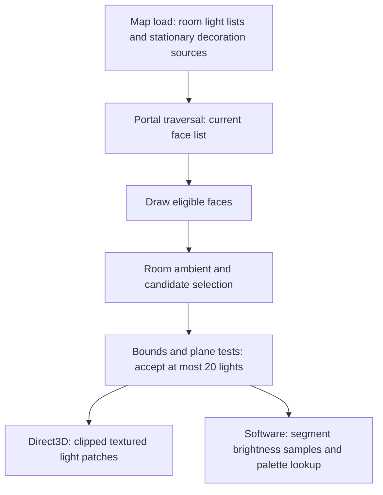

# Original MM8: why static dungeon lighting was inexpensive

Investigated 2026-10-01 with Rizin 0.10.0, local build commit
`c329b50b1ce87e32168f46e8a29d019b747c4117`. Target: `mm8_orig/MM8-Rel.exe`, 1,163,264 bytes,
preferred image base `0x400000`, SHA-256
`5326d56459ca74126447bcfd07a8cc85a419663e2281500f0f043f13ffe77a0b`.
The executable matches the [GOG-verified original](GOG_INSTALLER_VERIFICATION.md), rather than the patched
`mm8.exe`. Addresses below are preferred virtual addresses in this exact executable. No executable or engine
code was changed. This investigation rechecked the relevant instructions, rather than relying on reference names.

**MM8 reduced static-light cost through visibility, precompiled room light lists, cheap geometric rejection,
bounded surface lighting and simple rasterization. Its ordinary indoor illumination was still evaluated at draw
time.** Static source registration and cached shade palettes should not be mistaken for baked surface lightmaps.
The investigation establishes the algorithms; it does not measure a near-zero frame-time impact.

See [LIGHTING.md](LIGHTING.md) for the wider lighting investigation and
[OPENYAMM_LIGHTING_COMPARISON.md](OPENYAMM_LIGHTING_COMPARISON.md) for the existing renderer comparison.

## 1. Static sources and work performed at load time

There are two relevant source classes, with different selection costs:

| Source | Preparation | Surface selection |
| --- | --- | --- |
| Permanent BLV map light | Map light array and precompiled per-room light-index lists are loaded | Only the receiving face's owning-room list is scanned |
| Light-emitting decoration, such as a torch | Non-hidden, drawable decorations with a nonzero descriptor light radius are registered in the stationary pool during indoor loading | The stationary pool is scanned, with cheap bounds/plane rejection |

### Room lists come from the map

Loader `0x498050` reads room records with stride `0x78` (`0x4984c9–0x4984d7`). The block identified by the binary's
`L.RLData` allocation diagnostic is read at `0x498692–0x4986bd`. The loader then assigns each room's light-index
pointer at `room + 0x5c`, advancing through that block by `2 * room.lightCount`, where count is a signed 16-bit
field at `room + 0x58` (`0x4986e3–0x498714`). The archive/memory branch performs the equivalent relocation at
`0x499471–0x499501`.

This establishes **loaded, precompiled associations**, rather than rebuilding light-to-room membership every
frame. It does not reconstruct the original map compiler's rule for generating those associations. A light index
can occur in multiple room lists; the lists are receiving-room memberships, not necessarily one room per source.

The map light array is loaded with 20-byte records at `0x498b52–0x498b7f`. The other loading branch copies the
equivalent array at `0x4995b2–0x4995e3`. The loader assigns the default type byte from `0x4faf98` at
`0x498b94–0x498bb3` / `0x499604–0x499623`.

### Ordinary indoor torch sources are registered during loading

Indoor initialization `0x45f895` clears stationary count `0x52b174` at `0x45f9a2`, loads the map, then traverses
the decoration records. At `0x45fc1f–0x45fc90`, it checks the decoration's invisible bit, descriptor draw flag
and descriptor light radius before calling stationary inserter `0x4ad866`.

The verified source is placed at decoration XY and **decoration Z plus half the descriptor height**
(`0x45fc6a–0x45fc8d`). Radius comes from descriptor `+0x46`; RGB comes from descriptor `+0x50..+0x52` in the
hardware/colored-light branch, otherwise white. The pool stores 12-byte source records and caps insertion at 400.
These source records contain no frame-dependent flicker update in this initialization path.

Indoor frame preparation `0x43d049` clears the **mobile** count at `0x43d062`, but retains this stationary pool.
Its decoration billboard producer `0x43d6fa` animates/prepares sprites and some effects without re-registering
their stationary lights. The other stationary insertion callers found by Rizin are outdoor producers:
`0x47b61b` and `0x44db97`, with the latter called by outdoor frame `0x47b25b` at `0x47b412`.
Do not transfer their per-frame source rebuilding to the indoor path.

Consequently an animated flame sprite does not, by itself, imply that its ordinary indoor source position/radius
or surface lighting flickers. Every special effect or event-driven source change was not reconstructed here.
The party's Torch Light/camera light is a separate mobile source, inserted by indoor frame preparation.

## 2. Per-frame work is limited to receiving surfaces



Frame preparation calls portal traversal `0x43d61a`, which clears face count `0x52ce38` at `0x43d61f` and creates
the current list. Dispatcher `0x43e896` then iterates that list, rather than all map faces. It calls D3D face draw
`0x4b0ef5` at `0x43e8f4`, or software face draw `0x4b0427` at `0x43e92d`.
See [indoor visibility](INDOOR_EXPLORATION_AND_ACTIVATION.md) for portal and face-eligibility qualifications.

The D3D face path rejects invalid/invisible surfaces and empty clipped geometry before selecting lights.
Selection occurs at `0x4b111c`; light-polygon construction occurs at `0x4b11bc`. Thus lights in other hidden parts
of a dungeon do not each require a lighting pass. Stationary source rejection can still cost CPU time on the
faces that are drawn.

Selector `0x45b962` derives the receiving room from face `+0x4c`, obtains room darkness at `+0x66`, and collects:

1. Mobile sources.
2. Enabled permanent sources referenced by this room.
3. Stationary decoration sources.

All three loops stop when **20 sources have been accepted**, verified by comparisons with `0x14` at
`0x45b9b5`, `0x45b9f6` and `0x45ba4a`. This bounds polygon construction, not the total number of rejected
candidates examined. Selection is first accepted in source order; there is no strongest-light sort.

Helper `0x45ba81` first tests positive radius and six integer comparisons against the face bounding box expanded
by radius. It then tests signed plane distance against radius. Ordinary permanent/stationary sources behind the
receiving plane are rejected; mobile sources bypass that lower-bound test. Accepted entries cache position,
color, radius, reciprocal radius and plane distance for the following lighting work.

**Only permanent map lights benefit directly from the per-room index list.** A global stationary-pool scan is
still present. No intervening-wall ray test or shadow rendering was found in these paths; room membership,
face orientation, radius and clipping provide the principal containment.

## 3. Direct3D draws a small textured light patch

`0x45ad85` prepares the receiving surface basis and calls `0x45affd` for selected lights. The builder projects a
source onto the face plane, computes `sqrt(radius² - planeDistance²)`, constructs a textured quadrilateral, clips
it to the receiving polygon and prepares its transformed/projected vertices.

`0x45c8ba` binds the light texture and sets source and destination blending to **ONE / ONE** at `0x45c9d0` and
`0x45c9f2`. `0x45cc44` submits the resulting polygon as a triangle fan with pretransformed FVF `0x1c4` vertices.
The GPU interpolates and samples a ready-made light texture; it does not receive a list of point lights to
evaluate over the whole scene. The ordinary surface pass reaches this drawer through `0x4a2e4f`.

The CPU still constructs/clips these patches and the GPU still blends their pixels. The first light-polygon
count is cleared for each receiving face at `0x4b115a`; the late-list count is cleared during frame preparation
at `0x44d9ce`. The inspected path therefore provides no persistent, once-built static light-polygon cache.
The same reset/call sequence runs whenever these eligible surfaces are rendered.

Its economy comes from small affected areas, small source lists and simple rendering. Overlapping patches still
add submissions and overdraw. Reproducing this approach on a current GPU would not establish that it beats
cached vertex colors or a baked lightmap.

## 4. Software avoids a light loop at every pixel

Face setup `0x4aeaa2`, called at `0x4b04bc`, also selects at most 20 accepted sources and caches reciprocal radii
and plane distance. Rasterizer `0x4b0427` converts source locations into surface coordinates, then calls shade
sampler `0x4ae943` at segment endpoints (`0x4b0891`, `0x4b09a2`).

The sampler uses integer absolute differences and a cheap distance approximation. For sorted differences
`a >= b >= c`, distance is `a + ((11*b) >> 5) + (c >> 2)`. It applies falloff using the cached reciprocal, optional
authored face-gradient data, and clamps to a 0–31 fixed-point shade range. It avoids a Euclidean square root
for each shade sample.

At `0x4b09b3–0x4b09c4`, XOR and a `0xffff0000` mask detect whether endpoint shades have the same integer part.
If they do, the constant-palette path resolves one palette at `0x4b0c0b` for the segment. Otherwise the rasterizer
increments an interpolated shade while reading texture indices and shade-table colors. The neighboring
`0x4b09ce` branch also chooses the constant-palette path for a render flag; it is not the endpoint equality test.

Ordinary sprites use a scalar light sample at their world position through `0x43d28b`, then one shade for the
billboard. Software shade selector `0x41f1bd` uses precomputed palette banks. Neither path evaluates every source
for every sprite pixel. Quantization and interpolation are deliberate accuracy/cost tradeoffs.

## 5. What this means for OpenYAMM

The transferable principles are **precompute static contributions, preserve room associations, cull receivers,
keep dynamic work bounded, and invalidate only affected static data**. The original patch renderer's small light
footprints are useful evidence; its extra per-face processing/submissions are not a demonstrated optimization
for bgfx.

Current `IndoorRenderer.cpp` already stores static/decoration illumination in mesh vertex colors and refreshes
it when its lighting revision or color mode changes. The ordinary geometry call to
`selectDrawLightSetForBounds` explicitly passes `includeStaticLights = false`, keeping static sources out of the
per-fragment dynamic-light loop. Static RGB is interpolated as part of the ordinary surface draw.
This already avoids repeated static-source evaluation for unchanged geometry, although its subdivided mesh
has a memory/vertex cost and other lighting consumers still do CPU work.

Research alone does not justify replacing that cache. If static dungeon lights cause a present-day slowdown,
measure geometry subdivision, static-refresh frequency, source/frame preparation, billboard sampling and draw
submission separately. Compare against the original's room memberships and receiving-room ambient behavior.
This is guidance for a later optimization task, not an implemented change or a claim of measured bottlenecks.

## Reproduction and confidence

Use [the Rizin guide](RIZIN_GUIDE.md) and [lighting annotations](mm8_rel_5326d564_lighting.rz). In this workspace
the executable is available directly in its build tree:

```bash
sha256sum re_mm8/mm8_orig/MM8-Rel.exe
third_party/rizin/build/binrz/rizin/rizin -N -q -e scr.color=0 \
  -p re_mm8/work/mm8-rel-5326d564-base.rzdb \
  -i re_mm8/mm8_rel_5326d564_lighting.rz \
  -c 'pdf @ 0x45f895;pdf @ 0x43d049;pdf @ 0x43e896;pdf @ 0x45b962;pdf @ 0x4b0ef5'
```

Additional verified starts are `0x498050`, `0x45ba81`, `0x45ad85`, `0x45affd`, `0x45c8ba`, `0x45cc44`,
`0x4aeaa2`, `0x4ae943` and `0x4b0427`. Disposable assembly exports from this follow-up are ignored under
`work/indoor_static_light*_recheck.txt` and `work/indoor_static_lights_recheck.txt`.

High confidence: loaded room associations, ordinary indoor decoration registration timing/position, accepted-light
limits, visible-face dispatch, rejection tests, repeated patch construction and software endpoint/palette paths.
Not established: runtime frame-time measurements, every effect/flicker rule, upstream map compiler association
rules or patched-executable behavior. Reference layouts/names were checked locally against MMExtension
`01 common structs.lua` and OpenEnroth `Indoor.cpp` / `LightmapBuilder.cpp`; MM8 instructions remain the evidence.
No reference implementation code was copied.
