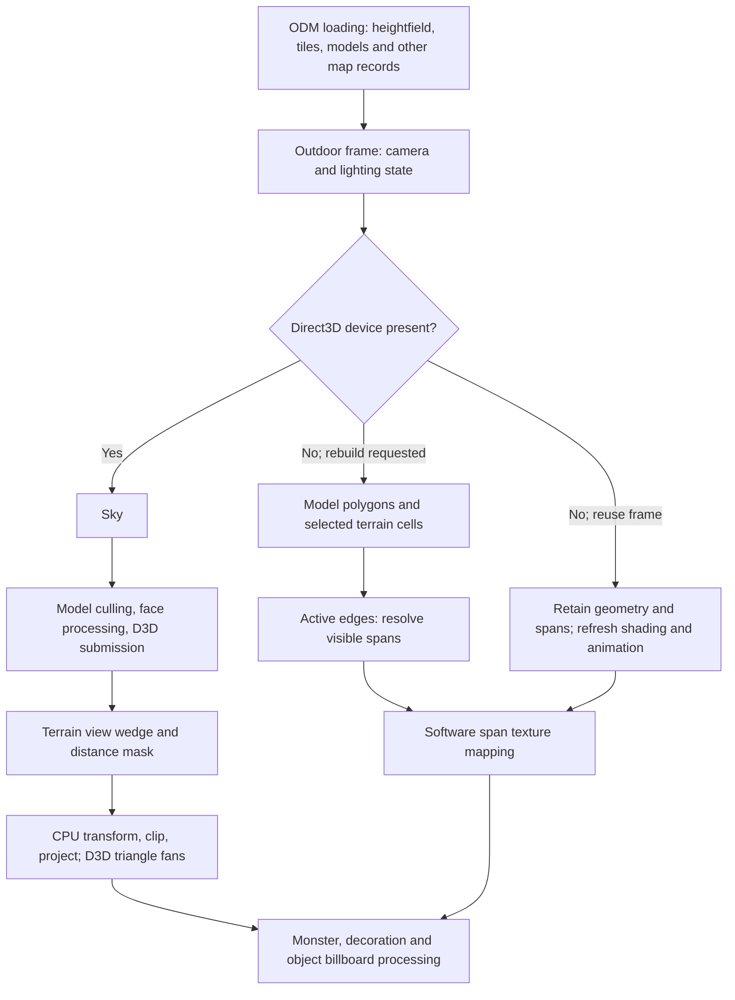

# MM8 outdoor rendering: executable investigation

Investigated on 2026-09-10 with Rizin 0.10.0 and rz-ghidra. Target: **`mm8_orig/MM8-Rel.exe`**, SHA-256
`5326d56459ca74126447bcfd07a8cc85a419663e2281500f0f043f13ffe77a0b`, PE32/x86, preferred image base `0x400000`.
This is the user-selected executable verified against the supplied GOG installer; see
[provenance](GOG_INSTALLER_VERIFICATION.md) and [tool setup](RIZIN_GUIDE.md).

For the current engine comparison and the tradeoffs behind its existing optimizations, see
[MM8 versus OpenYAMM rendering](OPENYAMM_RENDERING_COMPARISON.md).

All addresses below are **virtual addresses in this exact executable**, not file offsets or patched `mm8.exe`
addresses. Function names are descriptive research labels unless explicitly identified by a diagnostic string.
This is static binary research: it establishes implemented paths and conditions, not measured frame costs or which
path a particular installation currently selects. No executable or engine code was changed.

## What the renderer does

Outdoors consists of a regular heightfield, textured polygon models placed on it, a sky, and billboard objects.
The executable contains **separate Direct3D and software render paths**. Both perform substantial CPU visibility,
geometry and lighting work. Direct3D receives already transformed/projected vertices. The software renderer builds
an active-edge representation, resolves which polygon owns each visible horizontal span, then texture-maps those
spans. It can reuse this geometry/visibility work on frames that do not request a rebuild.

The main optimizations verified here are restricted terrain traversal, a precomputed distance mask, whole-model
visibility tests, face rejection and conditional clipping, flat-terrain fast paths, software mipmaps and segmented
perspective mapping, cached lighting data, reusable work buffers, and conditional software redraws. The inspected
terrain paths do not implement a distance-dependent coarsening of the heightfield mesh.

The follow-up investigation below covers [billboards and sprites](#8-billboards-and-sprites-detailed-trace),
[sky](#9-sky-rendering), and [texture loading and reuse](#10-textures-loading-reuse-and-quality-shortcuts).
It establishes separate software and Direct3D techniques rather than assuming they share the same rasterizer.



This diagram omits ancillary lighting/effect preparation and the UI. It describes call flow, not a claim that every
effect is drawn immediately at its preparation call.

## 1. How ODM becomes renderable data

`0x47df28` is the large ODM loader, anchored by references to `.odm` and `F:\MM8src\MM8\Code\Odmap.cpp`.
Its file-reading and decompressed-memory paths load fixed terrain arrays and allocate each model's variable-sized
arrays. Model pointers are established for runtime use; the renderer does not interpret raw ODM bytes every frame.

| Runtime data | Address or layout | Binary evidence |
| --- | --- | --- |
| Outdoor object | `0x6ceae0` | Call-site object addresses and consistent member accesses |
| Height samples | Pointer at `0x6ceb98`, object `+0xb8` | Loader copies `0x4000` bytes; `0x47ffea` indexes `y*128+x` and shifts byte height left by 5 |
| Tile IDs | Pointer at `0x6ceb9c`, object `+0xbc` | Separate `0x4000`-byte load; terrain material lookup is separate from height lookup |
| Third byte map | Pointer at `0x6ceba0`, object `+0xc0` | Another `0x4000`-byte load; precise attribute semantics not needed for this rendering trace |
| Model count / array | `0x6ceb94` / `0x6cebbc` | Both model renderers iterate count and advance model pointer by `0xbc` |
| Model vertices | Count `+0x44`, pointer `+0x48` | Loader allocates count times 12; faces fetch three integer coordinates through vertex indices |
| Model faces | Count `+0x4c`, pointer `+0x54` | Loader and rendering loop use `0x134` bytes per face |
| Model ordering / BSP | Pointers `+0x58` / `+0x60`, BSP count `+0x5c` | Loader reads ordering words and 8-byte BSP records; presence does not establish their use for rendering |
| Sky texture index | `0x6cebcc` | Used by the sky paths |

The terrain has **128×128 height samples**, with **512 world units between samples** and **32 units per stored
height increment**. In `0x4808b6`, generated vertices follow:

```text
worldX = (gridX - 64) * 512
worldY = (64 - gridY) * 512
worldZ = heightByte[gridY * 128 + gridX] * 32
```

`0x48a3a7` and `0x47ffea` return zero outside grid indices 0–127. Sample count should not be confused with a
128×128 set of fully interior quads: quads use neighboring samples, and boundary behavior matters.
Terrain material lookup at `0x48a354` and flag lookup at `0x48a302` happen when constructing a cell's polygons.
The complete tileset/transition decoding is outside this trace.

The local MMExtension structure descriptions corroborate the member layout. Their absolute MM8 addresses target
a different binary: use the original addresses above, not the reference's `0x6cebd0` outdoor base.

## 2. Frame orchestration and reuse

`0x47b25b` is the central outdoor rendering entry in this trace; the wrapper at `0x43f7c5` calls it at `0x43f7e0`.
It derives camera XYZ/yaw/pitch from party state and tests the Direct3D pointer at `0xf01908`.

For Direct3D it calls the sky routine `0x479f2d`, model renderer `0x47893a`, and terrain dispatcher `0x4808b6`.
For a software rebuild it calls `0x479395`, `0x4808b6`, `0x4883ca`, and `0x488796`; software texture drawing then
runs through `0x4887ca`. With a zero rebuild argument and no Direct3D device, it skips geometry generation and
span resolution and calls `0x479d20`, which walks existing polygons and refreshes sunlight shades and animated
model textures.

This is **reuse of visibility/geometry**, not proof that the entire old framebuffer is simply displayed again.
Software texture/material drawing and billboard processing still occur. The upstream rules that decide every
rebuild trigger were not exhaustively traced; do not replace them with an assumed “camera moved” test.

`0x48317c` clears three fields in each previously used polygon record rather than clearing the entire capacity.
`0x48319e` resets frame counters and camera basis data. `0x487e58` allocates and initializes software work buffers,
with branches that retain existing allocations. `0x47b04f` is a useful outdoor setup caller.

## 3. Terrain selection and geometry

### View wedge and lookup mask

`0x4808b6` builds a bounded camera-facing region in terrain-grid coordinates. It chooses among eight yaw sectors,
steps two view-boundary rays using fixed-point increments and tangent lookup data, and produces row/column strips.
The wedge uses a padded angle derived from the horizontal field-of-view setting, capped at 90 degrees, and a small
height-dependent offset. It is conservative selection, followed by polygon-level rejection.

Traversal bounds use the radius at `0x6f2f58`. Inside each strip, both terrain emitters index the precomputed table
at `0x7ac30c` using absolute grid offsets. A zero first byte skips the cell; a distance word at record `+2` is reused
in its polygon record. Each table record occupies four bytes.

`0x4807c0` builds this 128×128 table during setup from distance bands expressed in tiles. Distances are calculated
there, instead of performing a square root for every candidate cell on every frame. The table sets a byte to 1 in
the first band, 2 in the following accepted ranges, and 0 outside the final radius. In both inspected emitters,
this byte is tested for **nonzero**, not used to select a coarser terrain mesh.

### Vertex and polygon work

The dispatcher fills two adjacent row/column vertex arrays at `0x83f758` and `0x843f58`, with 48-byte working
vertices. It calls `0x4348db` to transform them and `0x434f8a` to project them. Cells in the strip reference these
arrays, sharing transformed corner data. The implementation fills both arrays for each strip; this is not evidence
of persistent GPU mesh storage or a complete inter-strip transform cache.

`0x4815f0` emits terrain for Direct3D; `0x482510` prepares software terrain polygons:

1. Consult the distance table and retrieve the four cell corners.
2. Reject a cell wholly behind the near plane or wholly beyond the far plane (`0x4831bf`). The normal near
   threshold for terrain/model polygons is 8 units; far distance is read from `0x6f2f1c`.
3. If all four corner heights match, process one quad. Otherwise process two triangles. The flat-cell path saves
   polygon setup and can submit a single four-vertex fan; the GPU still rasterizes the quad as triangles.
4. Check facing and construct the plane (`0x48327e`), look up material/flags, and obtain terrain normal data.
5. Clip crossing polygons as required, project the resulting vertices, and submit them or construct software edges.

Normal indices are read from `0x79b25c` (two 16-bit entries per grid location) into a shared normal array through
`0x7ab25c`; `0x77b258` is its count. This avoids deriving the lighting normal from scratch for every rendered cell.
Normal generation/deduplication policy was not separately reconstructed.

**No geometric distance LOD was found in these two terrain emitters.** They walk neighboring grid cells with unit
steps and choose quad versus triangles by height equality. Neither the names `gridband*` nor `terrain_subdivsize`
are evidence of quadtree terrain or progressive mesh simplification in this executable.

## 4. Outdoor models and visibility

The diagnostic at `0x4fe094`, referenced at `0x478967`, explicitly identifies the Direct3D **RenderBuildings**
path at `0x47893a`. It handles ODM polygon models, not only buildings in the everyday sense.

Both this function and software counterpart `0x479395` scan the model array and call `0x479a4c` before processing
faces. That helper uses the model's bounding center X/Y (`+0xac`, `+0xb0`) and radius (`+0xb8`), camera angles,
and horizontal field of view. It performs conservative horizontal view-boundary tests with radius padding and
rejects models beyond the configured far distance plus `0x800` (2048). A separate output identifies close models
using radius plus `0x100` (256). This is not a full six-plane bounding-box test.

The helper uses `0x46155d` for a cheap distance estimate. With sorted nonnegative components `a >= b >= c`, that
routine returns `a + ((11*b) >> 5) + (c >> 2)`. The model caller supplies absolute horizontal offsets and zero for
the third component: it avoids a square root at this stage.

For accepted models, the normal rendering path:

- Iterates faces with stride `0x134`; skips invisible flag `0x2000` at face `+0x1c`.
- Fetches indexed vertices, transforms them, and records whether near/far clipping is necessary.
- Uses `0x48341f` to test facing and form a usable plane; it handles degenerate initial vertex combinations.
- Computes shading and UVs, including flag-dependent texture animation, clips when necessary, and submits the face.
- Calls additional lighting/decal helpers when their counts/flags require work. Special/debug face branches exist;
  the normal rejection path should not be generalized to every flag combination.

Direct assembly confirms a sequential face loop (`0x479346`–`0x479358`) nested in a sequential model loop
(`0x479361`–`0x479374`). **The inspected outdoor model-rendering paths do not traverse the loaded model BSP to
order visible faces**, and no whole-map portal/PVS traversal was found in this chain. This does not establish that
BSP/order data are unused by collision, picking, or other engine systems.

Model geometry that survives these tests can still be hidden by another model or terrain. Coarse culling is not
the same as occlusion culling; the software span resolver handles overlap later. No CPU terrain-horizon occlusion
test or GPU occlusion-query mechanism was identified in the inspected Direct3D submission path.

## 5. What Direct3D actually receives

Model polygons go to `0x4a1b10`; terrain polygons go to `0x4a2581`. These populate a reusable vertex array at
`0x7bc310`, bind textures, set render states, and issue `IDirect3DDevice3::DrawPrimitive` calls. The COM device is
reachable through `[*0xf01908 + 0x38]`.

At `0x4a2154`–`0x4a2166`, for example, the binary pushes:

```text
flags       = 0x10       D3DDP_DONOTLIGHT
vertexCount = current polygon's vertex count
vertices    = 0x7bc310
FVF         = 0x1c4      XYZRHW | DIFFUSE | SPECULAR | TEX1
primitive   = 6          TRIANGLEFAN
call device vtable + 0x70
```

The local Direct3D interface definitions confirm slot `+0x58` as `SetRenderState`, `+0x98` as `SetTexture`, and
`+0xa0` as `SetTextureStageState`. `0x10` means **do not light**, not “do not clip.”

The 32-byte submitted vertices contain screen XY, depth, reciprocal W, colors and one UV pair. The model path
computes depth as `1 - farDistance / (1000 * cameraDepth)` and reciprocal W approximately as `1 / cameraDepth`.
Thus CPU code transforms, projects and supplies lighting; the Direct3D device receives pretransformed vertices for
texturing/rasterization. Depth-write state is explicitly toggled around additional passes. Full device creation,
depth-format selection and all initial render states were not reconstructed here.

Submission is per processed polygon, with extra passes in some lighting/fog branches. These functions do not show
an entire ODM uploaded once into a static vertex/index buffer, instanced models, or a global material-sorting pass.
Those are possible modern OpenYAMM choices, not techniques established by this trace.

## 6. Software visibility and texture mapping

`0x487f7e` turns projected polygons into edges and surface records. `0x4883ca` then walks screen scanlines:
it inserts/removes active edges, maintains X ordering, evaluates surface depth ordering, and emits the visible
span between successive boundaries. Spans are linked to their owning polygon at polygon `+0x40` / `+0x44`.
Edge X is advanced incrementally between rows.

This avoids texture-mapping every covered pixel of every hidden polygon. Geometry processing still costs time,
and billboards/effects have their own later paths; it is not a claim of zero overdraw for the complete frame.
`0x488796` performs a further per-polygon span pass through `0x45c53d`; its complete lighting role remains unnamed.
Final software material/span drawing is dispatched by `0x4887ca`, including sky handling for remaining spans.

`0x485c09` exposes two further optimizations particularly clearly:

- **Distance mipmaps:** it chooses texture pixel pointers at texture offsets `+0x30`, `+0x34`, `+0x38`, or `+0x3c`,
  adjusts dimensions/UV shifts for the selected level, and consults terrain mip-distance thresholds. The fourth
  level is conditional on another rendering setting. `0x485491` provides another terrain mip-selection path.
- **Segmented perspective mapping:** it divides a horizontal screen span into a leading alignment portion,
  fixed-size runs and a remainder. It evaluates perspective coordinates at run boundaries and interpolates within
  the run. `terrain_subdivsize` and `terrain_subdivpow2` set that pixel-run size and shift; they do not subdivide ODM
  cells. This reduces expensive divisions per pixel, trading some perspective accuracy for speed.

Specialized rasterizers handle material/plane cases rather than using one universal inner loop. Building span
processing also exposes run-size adaptation: the building branch in `0x4887ca` starts with 32/shift-5 and switches
to 8/shift-3 under a plane-gradient test. Do not assume the INI setting alone describes every rasterizer branch.

### Settings versus effective values

The INI reader at `0x465936` and outdoor setup at `0x465f96` both write rendering settings. The latter's outdoor
branch (`[0x6f38b8] == 2`) overrides several values. Reporting the reader's defaults alone would be misleading.

| Setting | INI-reader default | Outdoor setup behavior observed |
| --- | --- | --- |
| `gridband1/2/3` | 10 / 15 / 25 tiles | Writes 10 / 15 / 20 when byte `0x6f38e0` is zero; calls distance-mask builder with current bands |
| Terrain mip distances | 2048 / 4096 / 8192 | Writes 1024 / 2048 / 4096 |
| Building mip distances | 1024 / 2048 / 4096 | Writes 1024 / 2048 / 4096 |
| `dist_mist` / far threshold | 8192 | Writes 8192 when byte `0x6f38e0` is zero |
| Terrain subdivision size / power | 16 / 4 | Consumed by software span mapper `0x485c09` |
| Building subdivision size / power | 32 / 5 | Separate settings; branch-specific handling needs to be respected |

The override-control byte was not named in this investigation. These are binary defaults and branch effects, not a
readout of live settings. Fog and distance shading also change with map/time state; `0x48a854` starts the per-frame
fog update. The view has a finite geometry range, but fog is not itself proof of an occlusion algorithm.

## 7. Billboards, lighting and capacity limits

After world geometry, `0x47b25b` calls monster preparation `0x47c1d2`, optional decoration preparation `0x47b61b`,
object preparation `0x47bca5`, and billboard dispatch `0x47c8aa`. The decoration call is gated by `0x6f2f68`.
Billboard dispatch selects software `0x4ad16d` or Direct3D `0x4a3f0b`.

Monster/object preparation selects sprite animation and one of eight view directions, transforms positions,
rejects depths outside approximately 4 to the configured far threshold, and applies a horizontal view test.
Decoration preparation also checks projected extents. Accepted entries share a 52-byte record array at `0x523908`
with count `0x529e98`; each of these producers returns when that count exceeds 499. Visibility and animation
preparation here should not be confused with the monster AI update schedule.

Sun-vector updates at `0x48a779` are gated in the main entry by a change in the party's minute field compared with
`0x6f255c`. Faces/cells then use normal-dot-light shading and compact shade values. Together with normal lookup,
this avoids recomputing the sun direction and terrain normals for each polygon.

The renderer uses fixed capacities as well as culling. For example, terrain emitters check polygon count
`0x6f2f3c > 0x7ce` before accepting further work. Software edge preparation checks counts around 1999 surfaces and
5979 edges; span generation checks `0x6f2f48 > 0x3a96` (14998). The allocator reserves 360000 bytes for 24-byte spans
and 312000 bytes for 52-byte edges. These early exits bound work but can also omit geometry under overload; they
are not adaptive quality selection or a modern recommendation for OpenYAMM.

## 8. Billboards and sprites: detailed trace

### Animation and direction selection

The producers described in section 7 build render records for existing objects. `0x44c26c` selects an animation
frame from a contiguous array of 60-byte sprite-frame records. For an animated sequence with nonzero total duration,
it computes `(time >> 3) % totalDuration`, then walks frame durations until it finds the frame containing that phase.
An unanimated entry returns directly. `0x44c2bc` selects using a reversed phase for the callers that need it.
This is frame-table selection, with no skeletal animation or interpolated sprite-image generation in these paths.

The eight viewing directions are selected from the angle between the camera and object, adjusted by object facing.
Frame `+0x18` contains eight 16-bit sprite indices. Direction-dependent flag bits can request horizontal mirroring;
for example, decoration preparation tests `frameFlags & (0x100 << direction)` and sets the render mirror bit.
Both software and D3D consume that bit. This permits shared artwork across directions without storing a separately
flipped image. The trace establishes that capability, not how many frames in the shipped art exploit it.

Animation/frame and some light preparation happen **before** the final projection/visibility checks in the producer
functions. Do not claim that invisible objects incur no animation-selection cost. The 500-entry producer limit
is a visible-record limit, separate from the resource-cache limits below and the D3D queue capacity.

### Software: cropped scanlines and palette lookup

`0x4ad16d` is the shared software scaled-sprite rasterizer called by outdoor billboard dispatch. Its input sprite
has original width/height at `+0x10/+0x12` and a line-table pointer at `+0x20`. Each 8-byte line record contains:

| Offset | Meaning established by the reader and rasterizer |
| --- | --- |
| `+0` | Signed left occupied X; `-1` marks an empty source row |
| `+2` | Signed right occupied X |
| `+4` | Pointer to that row's palette-index bytes |

`0x4acbca` loads these line records, loads or decompresses the pixel buffer, and converts the row data offsets into
pointers once. This is a row-bounds representation; it is not evidence that every transparent run inside a row is
separately encoded. The rasterizer still tests individual pixel indices inside the retained horizontal interval.

The rendering steps and shortcuts are:

1. Compute scaled destination bounds and inverse X/Y increments once. Sampling uses 16.16 stepping rather than
   a perspective division for every pixel: a camera-facing sprite uses one depth and scale for the whole image.
2. Clip the destination rectangle to the viewport, unless a caller flag bypasses that clipping.
3. Map each destination row to a source row. An empty source row skips pixel work immediately.
4. Use the row's left/right bounds to skip transparent exterior margins; clip the remaining interval.
5. Read an 8-bit palette index. Index zero leaves the destination unchanged. A nonzero index selects a 16-bit
   output color from the chosen palette.
6. On the normal depth-tested branch, compare the sprite's packed depth/identity value against the auxiliary
   per-pixel buffer and update color and that buffer only when accepted. A separate zero-depth argument path skips
   this test; it should not be generalized to normal world sprites.

The dispatch path selects shading palettes through `0x47ca4b` and `0x41f1bd`. The latter returns a 512-byte palette
bank using palette/shade inputs and mode flags. Thus much of software sprite shading becomes a table selection
followed by one indexed color lookup per accepted pixel. The rasterizer has separate mirrored loops, reversing
destination traversal while retaining the original pixel resource.

The auxiliary buffer in this path uses four bytes per pixel and a 640-pixel row stride; the color framebuffer has
its own supplied pitch. The value should not be treated as a plain floating-point Z buffer: the outdoor dispatch
combines depth with record identity. Preserve the actual representation if reproducing original picking/occlusion.

### Direct3D: cropped quads, depth ordering, and blend-state reuse

`0x4a3f0b` **queues** the outdoor billboard; it does not issue its own `DrawPrimitive`. It uses hardware sprite
metadata to turn the projected anchor and scale into four pretransformed vertices. The metadata includes original
buffer dimensions, occupied-area offsets and occupied-area dimensions. This keeps native sprite placement while
restricting the rendered rectangle to the stored image area.

The four vertices use UV corners `(0,0)`, `(0,1)`, `(1,1)`, `(1,0)` and share depth, reciprocal W, diffuse color and
fog/specular value. Mirror handling changes the horizontal geometry around the anchor. No CPU operation generates
a flipped texture, and there is no per-pixel CPU lighting loop in this D3D queue builder.

The full queue-to-draw chain is:

```text
0x47c8aa  dispatch accepted outdoor billboard records
  0x4a3f0b  construct cropped D3D quad
    0x4a15c4  find insertion position in depth-sorted queue
0x4a1a7c  finish outer rendering scope
  0x4a16af  draw queued entries in reverse order
    0x4a1839  change blend mode when needed
```

Queue records occupy `0x9c` (156) bytes at `0xfc4fd0`; count is `0xfeb130`. `0x4a15c4` uses binary search by depth,
then shifts records to insert into ascending order. `0x4a16af` walks from the last record to the first, producing
**back-to-front drawing**. This supports transparent sprites; sorting by one depth per billboard does not solve
arbitrary intersecting translucent geometry. Binary search reduces comparisons, but moving whole records still
makes repeated insertion potentially quadratic in copied bytes.

At the start of queue drawing, it sets texture addressing to **clamp**, enables alpha blending, disables depth
writes, and disables face culling. Disabling depth writes is not disabling depth tests. The
[occlusion follow-up](BILLBOARD_OCCLUSION.md#depth-testing-against-indoor-walls) verifies explicit device
initialization with Z testing enabled and `LESS`; queue drawing retains those depth-test states. The helper
`0x4a1839` selects:

| Queue blend mode | Blend factors and related handling |
| --- | --- |
| `0` | Source alpha / inverse source alpha; enables color-key handling |
| `1`–`3` | One / one additive blending; disables color-key handling and conditionally disables fog |

The draw loop remembers the last blend mode and calls that helper only when the next entry's mode differs.
However, it **binds a texture and submits a triangle fan separately for each entry**. This is blend-state reuse,
not an atlas/instancing implementation or a single draw call for all sprites. Ordinary outdoor entries select mode
0; a nonzero high byte of the supplied tint/effect value selects mode 3 in `0x4a3f0b`. Other producers also use the
shared queue, so all its records should not automatically be labeled monsters or decorations.

Queue drawing uses FVF `0x1c4`, as the world polygons do, and flags `0x18` (`DONOTLIGHT | DONOTUPDATEEXTENTS`).
It restores depth writes and other modified states after drawing. The scene-begin helper `0x4a1954` resets the
queue count; the outermost scene-end path calls the queue renderer at `0x4a1a98`, before device `EndScene`.

The insertion helper only grows the queue while count is below 999. At saturation it returns index zero without
growing the count, and the outdoor builder still writes the returned slot. Do not describe this as a clean
nearest-N selection or a safe “drop newest” policy. No saturation behavior was exercised in a running game.

## 9. Sky rendering

### Direct3D: a small number of projected polygons

The outdoor frame calls `0x479f2d` before models and terrain. It looks up the selected sky through `0x6cebcc`,
constructs four screen-space corners, and derives texture coordinates using the camera/sky mapping basis, pitch,
viewport and time. Time contributes to both texture coordinates; the sky scrolls by changing UVs rather than
rewriting or regenerating a texture every frame in this path.

The routine submits one four-vertex sky region through `0x4a2c7d` at call site `0x47a384`. Depending on the computed
horizon relative to the viewport bottom, it remaps/reorders corners and submits a second region at `0x47a72a`.
The second branch handles the lower screen region; it is not evidence of a second independent cloud layer.
This trace shows a projected textured sky with horizon handling, not a cube map, tessellated sky dome or volume.

`0x4a2c7d` uses wrapped texture addressing, creates 32-byte pretransformed vertices, and fixes their Z to
approximately **0.9999** (`0x3f7ff972`). It preserves the supplied reciprocal W and UVs, computes sky-specific shade
and fog values, binds the selected texture and draws a triangle fan. Flags are `0x18` as above.

The geometry/setup cost is bounded by these small polygons, independent of terrain density. The sky is drawn first
on this path, so hidden sky pixels may still cost GPU rasterization; this should not be confused with the software
renderer avoiding hidden sky spans.

### Software: draw only remaining spans

Near the end of `0x4887ca`, the sky path walks the span buffer and checks each span's frame stamp at `+0x0e` against
`0x6f2f04`. Spans already handled by world surfaces are skipped. Remaining spans receive sky material/mapping state;
map/time/render flags select textured or simpler fill branches.

The textured branch calls `0x486471`. It computes mapping parameters for a horizontal span and advances U/V by
increments inside the pixel loop. Sampling wraps with dimension masks and shifts; palette-index bytes become
16-bit colors through a selected shading palette. The loop processes pairs of pixels with remainder handling.
It also writes `0xffff0000` into the auxiliary depth/identity buffer for sky pixels.

The software sky's main savings are **not drawing sky hidden by world geometry**, performing expensive mapping
setup per span rather than per pixel, incremental texture addressing, and palette shading. The D3D and software
paths have visibly different implementation choices and even different time multipliers in sky mapping; identical
appearance or scrolling speed should be validated rather than assumed.

## 10. Textures: loading, reuse, and quality shortcuts

### Resource caches and hardware archives

The ordinary loaders reuse named resources. `0x411278` checks existing 72-byte bitmap records and returns an existing
index on a name match unless its caller requests bypassing that check. `0x4acd0f` checks existing 40-byte sprite
records, using software or hardware names as appropriate, before loading another resource. These are linear
loaded-resource searches, not per-frame hash-map or spatial-tree lookups. Render records subsequently hold numeric
sprite/texture indices or texture pointers.

The sprite loader checks a 1500-resource limit and allocates 60000 bytes for hardware metadata when first needed.
This is distinct from both the 500 accepted outdoor billboard records and the shared D3D queue's limit. Metadata
reuse avoids repeated resource loading; it does not by itself batch GPU draw calls.

The hardware renderer constructor `0x49dc42` opens:

- `data\d3dbitmap.hwl`, string `0x501f34` referenced at `0x49e066`.
- `data\d3dsprite.hwl`, string `0x501f20` referenced at `0x49e08e`.

The archive opener `0x450f23` checks a `D3DT` signature and loads a name/offset index. Reader `0x451090` binary-searches
that index, seeks to the selected entry and reads metadata plus a 16-bit pixel image. Entries can be stored raw or
compressed. Software bitmap/sprite paths instead load their native indexed data and palettes/row records from LOD
resources. The hardware sprite loader still reads native sprite metadata as part of setup; HWL pixels do not mean
the LOD is irrelevant.

`0x4a4f76` uploads a hardware sprite: it preserves original/cropped dimensions in the metadata, creates a surface
and texture, locks the surface, copies image rows while honoring destination pitch, unlocks, and frees the temporary
CPU image. `0x4a4d10` is the corresponding bitmap uploader. The normal billboard builder uses the stored texture
pointer; it does not perform archive I/O or decompression for each draw.

`0x4ad02b` checks lost sprite surfaces and reloads affected resources; `0x4ad131` is a full sprite texture reload loop.
These are restoration paths, not evidence that texture upload is part of every frame. Bitmap reloads also have a
separate path at `0x411d54`.

### Pixel formats and reducing texture work

The surface creator `0x49d911` explicitly sets 16-bit formats: a branch uses RGB565 masks; the branch selected by
the inspected sprite and HWL bitmap upload calls uses **A1RGB555** masks (`0x8000` alpha, `0x7c00/0x03e0/0x001f` RGB).
That cuts storage relative to a 32-bit texture but quantizes color and gives only one stored alpha bit. Alpha
blending in the sprite pass does not establish arbitrary smooth alpha in the source texture; filtering/tinting
can affect the final result.

`0x451090` also has an optional load-time reduction controlled by reader member `+0x61a94`: it halves both image
dimensions and calls packed-color helper `0x450fe6` to combine samples, replacing the temporary image. That yields
one-quarter as many stored pixels for even dimensions. This is texture-resolution reduction, not sprite geometry
LOD or proof the setting is active in the user's game. The exact user-facing configuration name was not recovered.

Software bitmap loading at `0x4113e0` establishes the mip pointers described in section 6. For mip-bearing data,
the half-, quarter- and eighth-dimension levels follow the base pixels in the loaded buffer; their areas use
`baseArea/4`, `/16` and `/64`. The software quality flag at `0x6f38c4` can omit the largest level and adjust
dimensions/masks. Texture quality and perspective-run size therefore reduce work independently of world geometry.

Do not transfer the software distance-mipmap settings directly to D3D. `0x49d911` sets a one-level texture in the
non-chain branch used by sprite upload and ordinary HWL bitmap upload. The bitmap uploader has a special `HDWTR`
name-prefix branch that requests/traverses attached mip surfaces and fills levels through `0x44fbaf`. This confirms
specialized water texture preparation, not a universal mip chain for every hardware sprite or terrain texture.
The complete active D3D minification/magnification filter configuration remains untraced.

### Animation and material state

`0x44cb61` selects animated bitmap-frame indices using duration tables, similar to sprite animation selection.
Model/terrain drawing uses existing texture pointers and flag-dependent UV shifts; special water handling chooses
from existing hardware texture pointers. The sky similarly animates its coordinates. These observed paths avoid
generating replacement image pixels each frame. This does not prove that every effect or texture in the engine
never changes its image data.

The bitmap loader identifies special `wtrtyl`, `lavtyl`, `tartyl`, and `wtrdr...` names and routes them through
dedicated handling. Full transition-tile decoding and all water/lava/tar passes remain separate questions.

### Which savings belong to which path?

| Technique | Software | Direct3D |
| --- | --- | --- |
| Sprite frame/direction lookup and mirroring | Shared preparation; mirrored pixel traversal | Shared preparation; mirrored quad placement |
| Remove transparent exterior sprite area | Empty-row and per-row bounds | Occupied-area quad metadata |
| Sprite shading | Palette-bank selection and indexed lookup | Shared vertex color/fog values on a quad |
| Sprite overlap | Per-pixel packed depth/identity comparisons | Back-to-front queue, blend modes, inherited depth test state |
| Reduce state changes | Specialized loops/palettes | Reuses consecutive blend mode; still binds/draws each entry |
| Hidden sky | Skips spans already drawn by world surfaces | Sky first; later world pixels can cover it |
| Texture reuse | Loaded indexed images, palettes and mip pointers | Loaded HWL images uploaded to reusable texture objects |
| Texture quality reduction | Select lower mip; optional omission of base level | Optional HWL downsampling; special mip-chain preparation |

## Reproduce and extend the investigation

Check the hash first. The annotation file only adds flags/comments; it does not patch bytes or install guessed
calling conventions. It is specific to this investigation's original executable.

```bash
sha256sum re_mm8/mm8_orig/MM8-Rel.exe
mkdir -p re_mm8/work
rizin -N -q -e scr.color=0 -c 'aaa;Ps re_mm8/work/mm8-rel-5326d564-base.rzdb' re_mm8/mm8_orig/MM8-Rel.exe
rizin -N -p re_mm8/work/mm8-rel-5326d564-base.rzdb -i re_mm8/mm8_rel_5326d564_outdoor.rz
```

Useful interactive probes:

```text
axt @ 0x4fe094
pdg @ 0x47b25b
pdg @ 0x4808b6
pdg @ 0x4807c0
pdg @ 0x4815f0
pdg @ 0x482510
pdg @ 0x479a4c
pdg @ 0x4883ca
pdg @ 0x485c09
pd 8 @ 0x4a2154
pd 13 @ 0x479346
axt @ 0x6f2ef0
axt @ 0x6f2f90
pdg @ 0x4a3f0b
pdg @ 0x4a15c4
pdg @ 0x4a16af
pdg @ 0x4ad16d
pdg @ 0x479f2d
pdg @ 0x451090
pdg @ 0x4acd0f
pd 10 @ 0x4a2d45
```

Broad `aaa` analysis produced overlapping candidate functions and some invalid inferred stack variables.
For `0x47893a` and `0x47df28`, `pdg` could fail with `Symbol var_1h extends beyond the end of the address space`.
A fresh, targeted analysis successfully decompiled the desired routine:

```bash
rizin -N -q -e scr.color=0 -c 'aF @ 0x47893a;pdg @ 0x47893a' re_mm8/mm8_orig/MM8-Rel.exe
```

Use the same pattern with another verified start address. Even successful decompilation has warnings and can
misidentify register arguments, exception-handler frames and temporary values. For example, `0x4807c0` receives
its first two bands in ECX/EDX, although the inferred prototype only displays the third stack argument. Confirm
calling conventions and important tests in disassembly; do not reproduce apparent null writes from malformed
pseudocode. Rizin returning exit status zero does not guarantee `pdg` succeeded.

For example, sky uploader `0x4a2c7d` decompiled with an apparent infinite vertex loop and an unreachable draw call.
Disassembly at `0x4a2d21`/`0x4a2d24` shows a decrement and conditional loop, followed by the actual draw at
`0x4a2d59`. Interpret the instructions, not that decompiler artifact. Scene helpers can also acquire unrelated
blocks under broad analysis; the short call chain at `0x4a1a7c` is confirmed directly in disassembly.

The ignored project and exports from this session are in `work/mm8-rel-5326d564-base.rzdb` and `work/outdoor/`.
They are disposable caches; the addresses, findings and small annotation file are the durable result.

Local references used to decode layouts/API constants, not as substitutes for executable evidence:

- `reference/MMExtension/Scripts/Structs/01 common structs.lua`: outdoor arrays, model/facet/BSP layouts.
- `reference/Misc-MM8Patch-2.5.7/MMPatches/MM8Patch/Direct3D.pas`: Direct3D interface slots and numeric constants.
- `reference/OpenEnroth-git/src/Engine/Graphics/Outdoor.cpp`: behavioral cross-check of pipeline roles only.
  Its evolved renderer is not evidence of this MM8 executable's optimization strategy.

## Implications and remaining scope

For OpenYAMM, this establishes the original data scale, terrain triangulation condition, conservative visibility
strategy, separate sprite handling, distance limits, and substantial differences between software and Direct3D
paths. Useful ideas to evaluate independently include restricting candidate terrain, rejecting whole models before
faces, sharing transformed terrain corners, and caching stable lighting work. Choose current GPU batching and
resource ownership based on OpenYAMM measurements; reproduce original behavior in new code when needed.

Remaining targeted questions are full material/transition decoding, all water/effect pass interactions, detailed
dynamic-light/decal work, all rebuild invalidation triggers, initial D3D depth/filter state, and measured per-frame
costs/cull counts on representative ODMs. This report does not infer AI scheduling or collision behavior from
render visibility. A runtime follow-up should identify the loaded executable/modules and renderer mode, then
instrument the addresses above with a fixed map, camera and settings before drawing performance conclusions.
